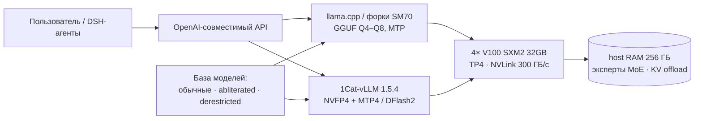
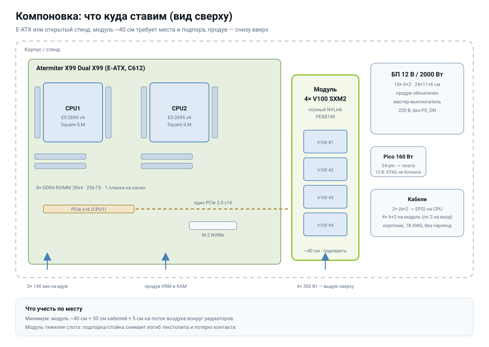
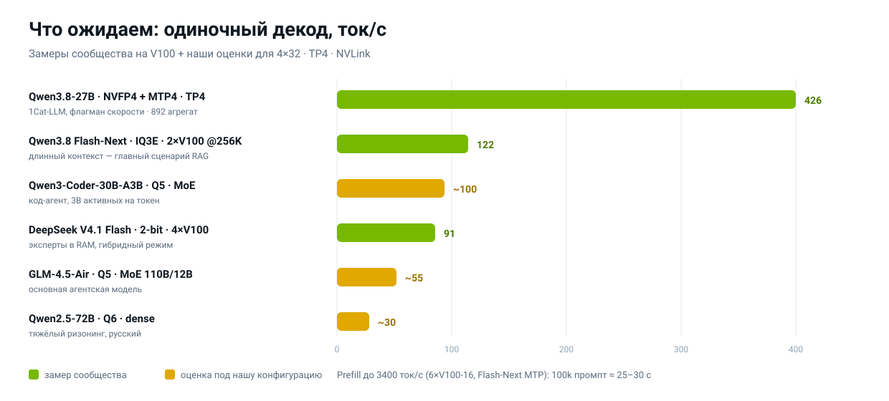

**← [Все проекты · All projects](https://github.com/rukazax?tab=repositories)**

# local-llm · Локальный ИИ-сервер на 4× Tesla V100 SXM2

<p align="center">
  
</p>

<p align="center">
  
  
  
  
  
</p>

**RU** · [English](#english)

---

## 🧭 Навигация

| Раздел | О чём |
|---|---|
| [О проекте](#-о-проекте) | что это и зачем |
| [Железо](#-железо) | конфигурация 4×V100 = 128 ГБ |
| [Архитектура](#-архитектура) | схема системы |
| [Как собираем](#-как-собираем) | компоновка, питание, порядок |
| [Смета](#-смета-и-что-почём) | сколько это стоит |
| [Движки](#-движки) | на чём и как гоняем модели |
| [Модели](#-модели) | сводка + полная база |
| [Скорости](#-скорости) | замеры и оценки |
| [Роадмап](#-роадмап-сборки-и-настройки) | этапы сборки и настройки |
| [Сборка и запуск](docs/ru/07-build-and-launch.md) | пошаговый мануал до первого токена |
| [Пул 128 ГБ](docs/ru/08-1cat-vllm-nvfp4.md) | 1Cat-vLLM 1.5.4, NVFP4, 425 ток/с |
| [Перспективы](#-перспективы-и-направления) | где это применять |
| [Выводы](#-выводы) | главное по итогам исследований |
| [Документация](#-документация) | RU/EN файлы базы знаний |
| [Источники](#-источники) | откуда данные |

**Документы базы знаний:**
[Железо](docs/ru/01-hardware.md) · [Роадмап](docs/ru/02-roadmap.md) · [Движки](docs/ru/03-engines.md) · [Модели](docs/ru/04-models.md) · [Исследования](docs/ru/05-research.md) · [Гибрид VRAM+RAM](docs/ru/06-hybrid-mode.md) · [Сборка и запуск](docs/ru/07-build-and-launch.md) · [Пул 128 ГБ](docs/ru/08-1cat-vllm-nvfp4.md) — и зеркала на английском в [docs/en](docs/en/).

---

## 💡 О проекте

Это сводная база знаний по сборке **домашнего LLM-сервера на списанных серверных ускорителях**.
Не «обзор для лайков», а рабочий документ: что купить, как собрать, что на этом запускается,
с какой скоростью, чему верить и куда развивать. Всё собрано из глубоких исследований
(RU и зарубежные источники: Хабр, Reddit r/LocalLLaMA, Level1Techs, GitHub-форки, научные работы)
и собственных расчётов под конкретную конфигурацию.

Формула проекта простая: **2017-й железо + 2026-й софт = скорость уровня флагманов за цену хлама** 🎯

---

## 🔧 Железо

| Компонент | Конфигурация | Примечание |
|---|---|---|
| GPU | **4× Tesla V100 SXM2 32GB** на одной несущей плате | Volta, SM70, тензор-ядра FP16, HBM2 |
| Несущая плата | заводской модуль 4×SXM2 + **полный NVLink**, Broadcom PEX8748 Gen3 | без NVLink скорость падает ~вдвое |
| Итого VRAM | **128 ГБ HBM2** | однородная конфигурация, TP4 без компромиссов |
| Связь с хостом | **один PCIe 3.0 x16**, питание 2×8-pin до 1200 Вт | NVLink делает GPU↔GPU, хосту хватает одного слота |
| CPU | **2× Xeon E5-2695 v4** — 18C/36T, 120 Вт | 36 ядер под CPU-часть гибрида |
| Материнская плата | **Atermiter X99 Dual X99** (ZX-DU99D4), E-ATX, C612 | 8× DDR4 DIMM, 2× M.2, два x16 |
| Охлаждение | радиаторы/водоблоки + сильный продув | воздух не тянет 4×300 Вт в закрытом корпусе |
| Питание | **12 В-БП «2000 Вт» (12V/166A) + Pico 160 Вт на 24-pin** | простой ~250 Вт · нагрузка 900–1100 Вт · пик **1400 Вт** |
| RAM хоста | **256 ГБ** DDR4-2400 REG ECC, 8×32 (RDIMM 2Rx4) | второй tier: эксперты MoE в RAM (см. 06); 76,8 ГБ/с на сокет |
| Диск | NVMe 4–8 ГБ/с | скорость загрузки моделей |
| ОС | Ubuntu 24.04+, UEFI, Above 4G Decoding, Re-Size BAR | обязательные пункты BIOS |
| Драйвер | NVIDIA **580.x** — последний с поддержкой Volta | зафиксировать, не гнаться за новыми |

Подробно — в [docs/ru/01-hardware.md](docs/ru/01-hardware.md), пошаговая сборка и запуск —
в [docs/ru/07-build-and-launch.md](docs/ru/07-build-and-launch.md).

---

## 🗺 Архитектура



---

## 🛠 Как собираем

Порядок такой, что каждый шаг проверяем до следующего: плата без модуля, потом питание, только потом GPU.

<p align="center">
  
</p>

1. **Платформа на столе.** CPU в сокеты по метке-треугольнику, кулер **Square ILM** крест-накрест,
   потом 8 планок RAM — сначала все 4 канала CPU1, затем CPU2. Смесь рангов = «не стартует».
2. **Первый старт без модуля.** Плата, два CPU, 256 ГБ: UEFI видит всё, память на 2400, Above 4G
   Decoding включён, Node Interleaving выключен.
3. **Питание.** 24-pin — с Pico, 2× EPS — с БП через переходники `6+2 → EPS`. Напряжения проверяем
   тестером до включения: 12 / 5 / 3.3 В ±5%.
4. **Модуль.** В верхний x16 на стороне CPU1, подпорка под текстолит, четыре 6+2 — **по два на каждый
   вход**. Без подпора 40-сантиметровая плата выворачивает слот.
5. **ОС и драйвер.** Ubuntu 24.04, драйвер **580.x** (последний для Volta), CUDA 12.8.
   `nvidia-smi topo -m` должен показать `NV4`/`NV6`, `nvlink -e` — нули.
6. **Приёмка.** `gpu-burn 300`: ≤85 °C, частоты не проваливаются, счётчики ECC пустые.

Питание — самая неочевидная часть, потому что БП здесь майнинговый (только 12 В):

<p align="center">
  
</p>

Команды, критерии приёмки и таблица «что делать, если» на 9 симптомов —
[docs/ru/07-build-and-launch.md](docs/ru/07-build-and-launch.md).

---

## 💰 Смета и что почём

Цены — фактические по купленным лотам и вилки по оставшимся (ноябрь 2026, Авито / Ozon / ЯМ).

| Позиция | Что именно | Цена | Статус |
|---|---|---|---|
| Модуль **4× V100 SXM2 32GB** + NVLink | б/у, проверен продавцом (70 ток/с одиночно, 841 батч) | 390 000 ₽ | **не покупался** — ориентир; собираем из несущей + 4 карт (см. ниже) |
| Материнская плата | Atermiter X99 Dual X99 (ZX-DU99D4), E-ATX | 4 000–9 199 ₽ | докуплено |
| CPU ×2 | Xeon E5-2695 v4, 18C/36T, 120 Вт | **1 111 ₽/шт = 2 222 ₽** | куплено |
| NVMe 2 ТБ | под систему и модели | 30 253 ₽ | куплено |
| БП + Pico | «2000 Вт» 12 В + 2× PICO-BOX 160 Вт | 4 464 ₽ | куплено |
| **RAM 256 ГБ** | 8× 32 ГБ DDR4-2400 REG ECC 2Rx4 | 12 006–14 000 ₽/шт → **96–112 тыс.** | купить |
| Кулеры ×2 | башня с тепловыми трубками, LGA2011-3 | **2 516 ₽** | куплено |
| Корпус | **Ginzzu V503**, ATX-куб, закалённое стекло | **5 240 ₽** | куплено |
| **СЖО, контур** | помпа Enermax ELC-NC200RGB 400 мл · шланг ПВХ 9,5 мм ×2 м · **24 фитинга** G1/4 «пагода» · антиутечка · **6× ARGB 120 мм** · **2× радиатор 360 мм ТСРП-ХП65-360** · пневмораспределитель | **20 979 ₽** | куплено |
| Питание: учёт и выключение | Wi-Fi розетка 20 А с **мониторингом потребления** · Tuya 16 А реле · переходник ATX 4-pin → EPS 8(4+4) | **1 162 ₽** | куплено |
| Расходники | термопрокладка 2 мм 16,8 W/mK · Arctic MX-4 8 г · винты M2.5×12 DIN912 ×10 · кулер JEYI для M.2 | WB, уточняется | куплено |
| Несущая плата | **4-слотовая SXM2 NVLink PCB + 2× V100 16GB — 1 комплект** (16-гиговые в TP4 не участвуют, остаются для bring-up и подмены) | **85 961 ₽** с налогами и доставкой | куплено |
| Карты V100 SXM2 32GB | **TP4 = 4 шт**: 3 на руках (все по карточке WB), **1 докупить** (AliExpress 62 863 ₽ + пошлина) | суммы трёх карт уточняются | 3 из 4 |
| V100 32G PCIe (медь) | отдельная карта, в TP4-сборку не входит | WB, уточняется | куплено |

**Итого по Ozon за закупку 22.11 — 36 583 ₽** (цены проверены по артикулам). Несущая с парой
16-гиговых карт — **85 961 ₽** с налогами и доставкой. **Потрачено подтверждённо: ~161–166 тыс. ₽**;
модуль за 390 000 ₽ с Авито **не покупался** — он был ориентиром.
Осталось: **RAM 8× 32 ГБ — 111 614 ₽** (2 комплекта 4×32 ГБ Atermiter 2400 ECC REG, 50 286 + пошлина
5 521 каждый) и **4-я V100 SXM2 32G — 70 271 ₽** с пошлиной. Три 32-гиговые карты уже куплены по
карточке WB, их суммы в смету пока не внесены: **«под ключ» = ~161–166 тыс. + стоимость трёх карт +
181 885**. Без карт это ~343–348 тыс. ₽.

Водяной контур собран под **240 Вт CPU** сразу и с запасом под водоблоки GPU: 24 фитинга — это
2 CPU + помпа + радиатор с запасом на 4 карты. В мануале — порядок опрессовки: сутки на
герметичность до подачи напряжения, дельта на CPU ≤ 35 °C, жидкость — дистиллят + биоцид.

Экономика: сравнимый объём VRAM (4× V100 = 128 ГБ) в облаке по публичным тарифам — порядка
$1–1,8 в час, то есть 0,8–1,5 млн ₽ в год при работе 24/7. Стенд отбивается за **5–9 месяцев**
непрерывной загрузки. Работает «по вечерам» — окупаемость растягивается, зато железо остаётся
и не зависит от тарифов и лимитов провайдера.

Экономить разумно на: корпусе (стенд дешевле), кулерах (б/у серверные), диске (SATA вместо NVMe
на старте). Неразумно — на памяти (смесь рангов), на питании (кабели и переходники) и на подпорке
модуля.

---

## ⚙️ Движки

| Движок | Статус на Volta | Для чего у нас |
|---|---|---|
| **llama.cpp** (+ форки SM70) | ✅ полная | все GGUF: MoE 30–120B, 72B dense, VL, embeddings |
| **1Cat-vLLM** (форк vLLM, **1.5.4**) | ✅ флагман | 27B NVFP4 + DFlash2 — **425 ток/с** одиночный, **1139–1264** aggregate (8×8K) |
| **llamacpp-v100 / llama.cpp-v100** (форки) | ✅ оптимизации под SM70 | Flash-Next на 2–6 GPU, MTP, +20% tensor-split |
| Ollama | ❌ выпилил Volta | не используем |
| upstream vLLM | ❌ требует CC ≥ 7.5 | только форки |
| PyTorch | ⚠️ сборки свёрнуты | инференс не на нём; fine-tune — через LoRA-стек |

Ключевой приём скорости — **спекулятивное декодирование MTP**: голова multi-token-prediction
уже внутри GGUF Unsloth, флаг `--spec-type draft-mtp` даёт **+33–39%** декода (65 → 90+ ток/с
на одной карте для 27B). Подробно — [docs/ru/03-engines.md](docs/ru/03-engines.md).

---

## 🧠 Модели

Полная база с умениями, скоростями и доверием — [docs/ru/04-models.md](docs/ru/04-models.md).
Здесь — сводка. Все влезают целиком в 128 ГБ вместе с контекстом.

| Модель | Тип | Размер | Зачем |
|---|---|---|---|
| GLM-4.5-Air-Derestricted | MoE 110B/12B | Q5 · 83.5 ГБ | основная агентская, tool-calling |
| Qwen3.8-27B (NVFP4 + DFlash2) | dense | 22 ГБ | скоростной агент: 425 ток/с одиночный |
| Huihui-Qwen3.8-27B-abliterated | dense | Q8 · 29 ГБ | универсал без отказов + зрение + 256K |
| Qwen3-Coder-30B-A3B-abliterated | MoE 30B/3B | Q5 · 21 ГБ | код-агент, ~100 ток/с |
| Qwen2.5-72B-Instruct-abliterated | dense | Q6 · 62 ГБ | тяжёлый ризонинг, русский |
| Qwen3-VL-30B-A3B-abliterated | MoE-VL | Q5 · 22 ГБ | зрение: документы, скрины, фото |
| Hermes 4-70B | dense | Q5 · 50 ГБ | SOTA по «отказности», tool calling |
| MiniMax M2.7 | MoE 230B/10B | IQ1_M · 61 ГБ | агент-флагман open-весов (MIT) |
| AliceAI-Foundation-80B-A3B | MoE 80B/3B | Q5 · 57 ГБ | лучший русский MoE |
| Qwen3-Embedding-4B | 4B | Q8 · 4.5 ГБ | RAG-вектора |

---

## 🚀 Скорости

Замеры сообщества на V100 (точные условия — в базе моделей); наши ожидания для 4×32 помечены «оценка».

```
Qwen3.8-27B NVFP4 + DFlash2 (1Cat, TP4) ████████████████████ 425 ток/с одиночный · 1139–1264 aggregate
Qwen3.8-27B GGUF + MTP (1 карта)       ████████████░░░░░░░░  65 ток/с @1K · 42 @128K
Qwen3-Coder-30B-A3B Q5 (MoE)           ██████████████████░░  ~100 ток/с (оценка)
Qwen3.8 Flash-Next IQ3E + MTP (2×32)   ████████████████████  122 ток/с @256K контекст (замер)
GLM-4.5-Air Q5 (MoE 110B/12B)          ██████████████░░░░░░  ~45–60 ток/с (оценка)
Qwen2.5-72B Q6 (dense)                 ████████░░░░░░░░░░░░  ~25–35 ток/с (оценка)
DeepSeek V4.1 Flash 2-bit (4×V100)     ███████████████░░░░░   91 ток/с (замер, expert offload)
Prefill до 3400 ток/с на 6×V100-16 (Flash-Next MTP) — чтение 100k промпта ≈ 25–30 сек
```

<p align="center">
  
</p>

Важные правила скорости: NVLink обязателен (без него вдвое медленнее), MTP-флаг включать всегда,
KV-кэш в q8_0 — на Volta это ёмкость почти без потери скорости (~2%), лимит 250–300 Вт/карту
теряет мало производительности.

---

## 🛠 Роадмап сборки и настройки

```mermaid
gantt
    title Локальный ИИ-сервер: этапы
    dateFormat X
    axisFormat %s
    section Железо
    Комплектация и проверка лотов      :0, 1
    Стенд: база + водоблоки + контур   :1, 2
    section Софт
    ОС + BIOS + драйвер 580 + CUDA 12.8 :2, 3
    Приёмка: verify-gpus (NVLink, ECC)  :3, 4
    llama.cpp + очередь GGUF            :4, 5
    1Cat-LLM + NVFP4 + замеры           :5, 6
    section Эксплуатация
    API/UI + интеграция с NAS           :6, 7
    Модели в работе + мониторинг        :7, 8
    Апгрейды: RAM 256 + 2-й сокет, NVMe :8, 9
```



Этапы с командами и критериями приёмки — [docs/ru/02-roadmap.md](docs/ru/02-roadmap.md).

---

## 🌱 Перспективы и направления

- **Агентика с приватностью**: DSH-агенты и код-агенты на локальных моделях — данные не покидают дом.
- **RAG-база знаний**: embeddings + 72B/VL ретрив и анализ своих документов.
- **Креатив и RP без фильтров**: abliterated/derestricted 27–70B.
- **Зрение**: разбор сканов, скриншотов, фото (VL-30B). Локальный OCR-конвейер.
- **Картинки и видео на том же железе**: Z-Image Turbo (1024²) и MiniMax H3 видео — через 1Cat-LLM.
- **Обучение своих моделей**: LoRA/QLoRA на 27–70B прямо на этом стенде (FP16 Volta подходит).
- **Мультиинстанс**: 128 ГБ позволяют держать 2–3 модели одновременно (27B + Coder-30B + embeddings).

---

## ✅ Выводы

1. **4×V100 32GB — однородная конфигурация без компромиссов**: TP4 в любом движке, любая модель
   до ~100 ГБ весов влезает целиком. Смешивать 16+32 не нужно — и было бы вредно.
2. **Экосистема Volta сжалась, но жива и целеустремлена**: llama.cpp и 1Cat-LLM целенаправленно
   оптимизируют SM70; Ollama/vLLM/PyTorch ушли. Наш стек подобран правильно.
3. **MTP-спекуляция — главный бесплатный ускоритель**: +33–39% декода флагом. Включать всегда.
4. **Uncensored-модели почти ничего не стоят по качеству** (Heretic-метод измерим и аккуратен),
   но их надо изолировать от инструментов с доступом к системе — принцип «модель без отказов +
   доступ к шеллу = риск».
5. **RAM — это второй tier, а не апгрейд «на вырост»**: 256 ГБ DDR4-2400 (8 каналов) дают
   MoE со 100+ млрд общих параметров ~5–15 ток/с; dense-модели в RAM не гоняем. Драйвер 580 —
   последний для Volta, стек фиксируем. Подробно — [Гибрид VRAM+RAM](docs/ru/06-hybrid-mode.md).
6. **Никакой локальный 27–120B не тягается с облачными флагманами в сложной агентике** —
   но для приватных задач, кода, RAG, зрения и креатива он даёт скорость и контроль,
   которых облако не даст.

---

## 📚 Документация

| RU | EN |
|---|---|
| [Железо](docs/ru/01-hardware.md) | [Hardware](docs/en/01-hardware.md) |
| [Роадмап](docs/ru/02-roadmap.md) | [Roadmap](docs/en/02-roadmap.md) |
| [Движки](docs/ru/03-engines.md) | [Engines](docs/en/03-engines.md) |
| [База моделей](docs/ru/04-models.md) | [Models database](docs/en/04-models.md) |
| [Исследования](docs/ru/05-research.md) | [Research](docs/en/05-research.md) |
| [Гибрид VRAM+RAM](docs/ru/06-hybrid-mode.md) | [Hybrid mode](docs/en/06-hybrid-mode.md) |
| [Сборка и запуск](docs/ru/07-build-and-launch.md) | [Build & launch](docs/en/07-build-and-launch.md) |
| [Пул 128 ГБ: 1Cat-vLLM + NVFP4](docs/ru/08-1cat-vllm-nvfp4.md) | [One 128 GB pool: 1Cat-vLLM + NVFP4](docs/en/08-1cat-vllm-nvfp4.md) |

## 📖 Источники

Хабр-серия о V100-серверах · Reddit r/LocalLLaMA (V100 Home Lab Bible) · Level1Techs (DIY backplane) ·
Angry Sysadmins · 1Cat-LLM · llamacpp-v100 форки · llamaperf.com · roksblog.de · обзор ULLM-экосистемы (IMC'26) ·
видео Simply Explained, Kiber Kuznitsa, l2oot. Полный список со ссылками — [docs/ru/05-research.md](docs/ru/05-research.md).

## Лицензия

[MIT](LICENSE) © 2026 rukazax

---

## English

Local AI server knowledge base built on **4× Tesla V100 SXM2 32GB = 128 GB VRAM (NVLink TP4)**.
A working document, not a review: what to buy, how to assemble, what runs, how fast, what to trust,
where to grow next. Built from deep research across Russian and international sources
(Habr, r/LocalLLaMA, Level1Techs, SM70 GitHub forks, an IMC'26 paper on uncensored-model ecosystems).

**Project formula: 2017 hardware + 2026 software = flagship-class speed for scrapyard prices.** 🎯

### Hardware

4× V100 SXM2 32GB on a factory 4-module NVLink carrier (full NVLink or you lose ~half the speed)
with a single PCIe 3.0 x16 uplink and 2× 8-pin feeding up to 1200 W; **2× Xeon E5-2695 v4**
(18C/36T, 120 W) on an **Atermiter X99 Dual X99** (E-ATX, C612, 8 DIMMs); a **12 V-only "2000 W"
unit (166 A) plus a PICO-BOX 160 W board that builds the 24-pin** (idle ~250 W, load 900–1100 W,
peak ~1400 W); host RAM **256 GB** DDR4-2400 REG ECC
(8× 32 GB RDIMM 2Rx4, 76.8 GB/s per socket) — the second tier where MoE experts live
(see [docs/en/06-hybrid-mode.md](docs/en/06-hybrid-mode.md)); NVMe 4–8 GB/s;
Ubuntu 24.04 with UEFI + Above 4G Decoding + Re-Size BAR, NVIDIA **580.x** — the last Volta driver, frozen.
Step-by-step build and launch: [docs/en/07-build-and-launch.md](docs/en/07-build-and-launch.md).

### Assembly

Board on the bench first: CPUs, square-ILM coolers, then all eight DIMMs (CPU1 channels before CPU2).
Boot **without the module** and confirm 256 GB at 2400 with Above 4G Decoding on and Node Interleaving
off. Then power: 24-pin from the Pico, 2× EPS from the 12 V unit through `6+2 → EPS` adapters, rails
measured before the first switch-on. Only then the module into the top x16 on the CPU1 side — on a
support, with **two 6+2 cables per input**. OS, driver 580.x, CUDA 12.8, `nvidia-smi topo -m` must show
NV4/NV6 and `nvlink -e` zeros. Acceptance: `gpu-burn 300` at ≤85 °C.
Diagrams: [chassis layout](assets/chassis-layout.svg) and [power topology](assets/power-topology.svg).

### Budget

Actual prices (Russia, Nov 2026): GPU module 4× V100 SXM2 32GB + NVLink 390 000 RUB — **never bought**, an earlier reference; the build
goes through the carrier + 4 cards; board 4 000–9 200, 2× E5-2695 v4 **1 111 each**, NVMe 2 TB 30 253,
PSU + 2× Pico 4 464, **CPU coolers 2 516**, **Ginzzu V503 case 5 240**,
**water loop 20 979** (Enermax 400 ml pump, 9.5 mm PVC tubing, 24 G1/4 fittings, leak-guard fitting,
6× ARGB 120 mm fans, 2× 360 mm ТСРП-ХП65-360 radiators, 4-way manifold),
**power monitoring and switching 1 162** (20 A Wi-Fi socket with energy metering, Tuya 16 A relay,
ATX 4-pin → EPS adapter), consumables (2 mm 16.8 W/mK pads, MX-4, M2.5 screws, M.2 cooler),
one 4-slot SXM2 NVLink carrier with 2× 16 GB V100 cards (**85 961 RUB** incl. tax and shipping; the 16 GB
cards are kept for bring-up and spares, not for TP4) and one V100 32G PCIe card. The TP4 set is **3 of 4 V100 SXM2 32GB bought; the fourth is still to buy**, as is RAM. RAM 8× 32 GB DDR4-2400 REG ECC = two 4×32 GB Atermiter kits, **111 614 RUB** incl. duty (50 286 + 5 521 each) still to buy.
**Checks on 22 Nov: 36 583 RUB (Ozon, verified by SKU). Confirmed spent: ~161 000–166 000 RUB**
(the 390 000 RUB Avito module was never bought — carrier and three 32 GB cards are in hand).
Remaining: RAM 111 614 + the fourth V100 SXM2 32G 70 271 (incl. duty). The three 32 GB cards were bought
from the WB listing but their sums are not in the table yet, so **turnkey = ~161 000–166 000 + the three
cards + 181 885** (~343 000–348 000 RUB before the cards). The same 128 GB of
VRAM in the cloud runs $1–1.8/h, i.e. 0.8–1.5 M RUB a year at 24/7 — the rig pays back in 5–9 months of
continuous load and keeps working after that.

### Engines

- **llama.cpp** and its SM70 forks — every GGUF: MoE 30–120B, dense 72B, vision, embeddings;
- **1Cat-vLLM** (vLLM fork, **1.5.4**) — 27B NVFP4 with DFlash2/MTP4 speculative decoding: **425 tok/s** single-stream, **1139–1264 tok/s** aggregate at 8×8K — see [docs/en/08](docs/en/08-1cat-vllm-nvfp4.md);
- Ollama and upstream vLLM dropped Volta — not used. PyTorch builds are winding down.

### Speed rules

NVLink is mandatory (without it — half the speed). `--spec-type draft-mtp` gives **+33–39% decode**
(the MTP head already ships inside Unsloth GGUFs). KV cache in q8_0 is capacity at ~2% speed cost on Volta.
A 250–300 W per-card limit costs almost no performance.

### Models

Everything below fits fully in 128 GB with context: GLM-4.5-Air-Derestricted Q5 (83.5 GB, main agent),
Qwen3.8-27B NVFP4+MTP4 (speed demon), Huihui-Qwen3.8-27B-abliterated Q8 (universal uncensored with vision
and 256K context), Qwen3-Coder-30B-A3B-abliterated Q5 (~100 tok/s code agent), Qwen2.5-72B-abliterated Q6,
Qwen3-VL-30B-A3B-abliterated Q5 (vision), Hermes 4-70B Q5, MiniMax M2.7 IQ1_M (61 GB, open-weight agentic
flagship), AliceAI-80B-A3B Q5 (best Russian MoE), Qwen3-Embedding-4B Q8 (RAG).
Full database with skills, speeds and trust levels: [docs/en/04-models.md](docs/en/04-models.md).

### Roadmap

Lots check → bench assembly (SXM2 seating, leak test) → OS/BIOS/driver/CUDA → acceptance
(4 GPUs, NVLink links, ECC counters) → llama.cpp + GGUF queue → 1Cat-LLM + NVFP4 + benchmarks →
API/UI + NAS integration → models in production + monitoring → upgrades (second socket + 256 GB RAM, NVMe, optional
2-card “instance B”). Details: [docs/en/02-roadmap.md](docs/en/02-roadmap.md).

### Directions

Private agentics (DSH agents, coding agents), RAG over your own documents, unfiltered creative/RP,
vision (documents, screenshots), image/video generation on the same rig (Z-Image, MiniMax H3 via 1Cat-LLM),
fine-tuning your own models (LoRA/QLoRA on 27–70B), multi-instance serving.

### Conclusions

1. 4×32 GB is a homogeneous no-compromise config: TP4 in any engine, models up to ~100 GB of weights fit whole.
2. The Volta ecosystem shrank but lives with purpose: llama.cpp and 1Cat-LLM target SM70 on purpose.
3. MTP speculation is the main free speedup — always on.
4. Uncensored models cost almost nothing in quality (Heretic is measurable), but keep them away from
   system-level tools: no-refusal model + shell access = risk.
5. RAM is a second tier, not a rainy-day upgrade: 256 GB DDR4-2400 (8 channels) runs MoE with
   100B+ total parameters at ~5–15 tok/s; dense models stay out of RAM. Driver 580 is the last for
   Volta — freeze the stack. Details: [docs/en/06-hybrid-mode.md](docs/en/06-hybrid-mode.md).
6. No local 27–120B beats cloud flagships at hard agentic work — but for private tasks, code, RAG,
   vision and creativity it gives speed and control the cloud cannot.

### License

[MIT](LICENSE) © 2026 rukazax

---

#local-llm #v100 #sxm2 #nvlink #localai #llm #llamacpp #1catvllm #nvfp4 #mtp #uncensored #abliterated #selfhosted #homelab #rag #ai-inference