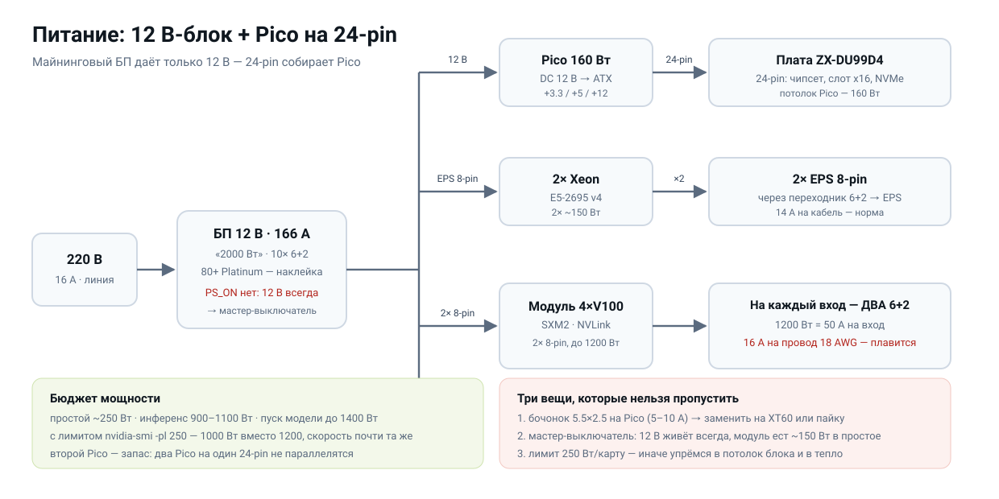

# 07 · Build and launch: step-by-step manual

**EN** · [Русский](../ru/07-build-and-launch.md) · [← README](../../README.md)

---

This is the working instruction from unboxing to the first token. Everything that can be checked
by a command is given as a command with the expected output: if the output differs, stop and fix.

## 0. Configuration of record (2026-11-20)

| Component | Exact part | Status |
|---|---|---|
| GPU | **4× Tesla V100 SXM2 32GB** on a single carrier board with full NVLink, Broadcom PEX8748 switch, **one PCIe 3.0 x16** uplink, **2× 8-pin up to 1200 W** | bought |
| Motherboard | **Atermiter X99 Dual X99** (ZX-DU99D4 family), E-ATX, C612, 2× LGA2011-3, 8× DDR4 DIMM, 2× M.2 NVMe | bought |
| CPU | **2× Intel Xeon E5-2695 v4** — 18C/36T, 2.1–3.3 GHz, 45 MB L3, 120 W, 40 PCIe 3.0 lanes, DDR4-2400 | bought |
| RAM | **256 GB = 8× 32 GB DDR4-2400 REG ECC (RDIMM 2Rx4)**, 1 DIMM per channel, 76.8 GB/s per socket | to buy |
| PSU | **12 V-only "2000 W" (12 V / 166 A, 10× 6+2)** + **2× PICO-BOX 12 V→ATX 160 W**: the board's 24-pin through a Pico, CPU EPS and the module straight off 12 V | bought |
| Disk | NVMe M.2, 2 TB | bought |
| Cooling | 2× LGA2011-3 coolers (square ILM), ≥3× 140 mm case fans | to buy/check |
| OS | Ubuntu 24.04 LTS | — |

Power envelope: ~250 W idle (V100 SXM2 does not power-save, ~42 W per card), 900–1100 W under load,
up to 1400 W peak while a model loads.

## 1. Before assembly

- Coolers must use **Square ILM** mounting; Narrow ILM will not fit this board.
- All 8 RAM sticks: **same model, same rank (2Rx4)**. Mixing vendors/ranks on a Chinese dual-X99 is
  the number one cause of "board does not post".
- Handle the V100 module **by the carrier PCB only**, never by the heatsinks or the NVLink bridge.
  Do not disassemble it: the SXM2 clamp is factory-calibrated.

## 2. Assembly order

### 2.1 CPUs and coolers

1. Open the socket, seat the CPU by the triangle mark, close the frame, lower the levers.
2. Paste a pea in the centre; tighten coolers crosswise — two turns on one screw, then the opposite.
   Spring screws bottom out, no force needed.
3. Connect **both 8-pin EPS** CPU connectors.

### 2.2 Memory

1. Fill **CPU1** first: 4 sticks into its 4 channels (outermost from the socket is usually slot 1).
   Then the same for **CPU2**.
2. With a single CPU half the DIMMs and part of the PCIe lanes are dead — we run two, so all 8 work.
3. Verify both latches closed and each stick sits flat.

### 2.3 The V100 module

1. Install into the **PCIe x16 on the CPU1 side** (usually the top slot).
2. Feed it **2× 8-pin, with TWO 6+2 cables into each input** (in parallel). The module pulls up to
   1200 W: that is ~50 A per input, while one 6+2 carries only three 12 V wires — 16 A per 18 AWG
   wire, which heats up and melts. See 2.5.
3. It is long and heavy — support it. A sagging slot breaks contact.

### 2.4 First boot

Boot **without the V100 module** first: verify board, both CPUs and all RAM. Add the module once the
system is stable and sees 256 GB.

### 2.5 Power rails: 12 V supply + Pico for the 24-pin

<p align="center">
  
</p>


This PSU is a mining unit: **12 V only** (166 A, ten 6+2 connectors), no 24-pin at all. A PICO-BOX
board (DC 12 V in, ATX 24-pin out, 160 W) builds the ATX rail the motherboard needs.

| Load | Fed from | Cable |
|---|---|---|
| Board 24-pin | Pico #1 | 24-pin to board; 12 V into the Pico |
| 2× CPU EPS 8-pin | PSU directly | 2× `6+2 → EPS 8-pin` adapter |
| V100 module, inputs 1 and 2 | PSU directly | **two** 6+2 per input |
| NVMe | Pico (+3.3 V) | — |
| Pico #2 | spare | **never parallel** with the first |

Four rules that cost hardware when broken:

1. **One 6+2 is a ~150 W part.** Feed the module with two cables per input.
2. **This PSU has no PS_ON**: 12 V is always live, so the V100 module sits powered (~150 W idle).
   Put a master switch or a smart plug in the 220 V line.
3. **The 5.5×2.5 barrel jack on the Pico** is a 5–10 A part while the input needs up to 13 A — replace
   it with XT60/solder, or bring 12 V in on a dedicated 6+2 lead.
4. **Cap the GPUs at 250 W each** (`nvidia-smi -pl 250`, see §4): 1000 W instead of 1200, ~1400 W total —
   that is the margin for a "2000 W Platinum" unit that costs 2 712 RUB.

If the ZX-DU99D4 has a dedicated **6-pin PCIe for the slot**, feed the slot from the PSU rather than
through the 24-pin: the Pico then carries only 3.3/5 V (~40 W) and its 160 W becomes headroom.

## 3. BIOS checklist

| Setting | Value | Why |
|---|---|---|
| Boot mode | **UEFI only**, CSM Disabled | otherwise some cards and NVMe are invisible |
| **Above 4G Decoding** | **Enabled** | 32 GB VRAM cards are invisible without it |
| **Re-Size BAR** | Enabled | if the board misbehaves, disable and retest P2P |
| IOMMU | Enabled | needed for VMs; disable if P2P breaks |
| PCIe speed | Gen3 / Auto | V100 is PCIe 3.0 |
| **Node Interleaving** | **Disabled** | otherwise NUMA locality is lost |
| Memory frequency | 2400 (or Auto) | E5 v4 caps at DDR4-2400 |
| Restore on AC loss | Power On | the server must come back by itself |
| Fan control | Performance / Full | 1200 W of GPUs in one box |
| Secure Boot | Disabled | simpler with NVIDIA DKMS |

## 4. OS and driver

```bash
sudo apt update
sudo apt install -y build-essential dkms linux-headers-$(uname -r) \
                    pciutils numactl hwloc lm-sensors
sudo apt install -y nvidia-driver-580-server
sudo reboot
```

580.x is the last branch supporting Volta (SM70). Do not "just update": CUDA 13 and newer drivers
dropped Volta.

### 4.1 Post-boot checks

```bash
nvidia-smi                 # 4× Tesla V100-SXM2-32GB, 32768 MiB, 580.x, CUDA 12.8
nvidia-smi topo -m         # NV4/NV6 between GPUs, SYS between GPU and CPU
nvidia-smi nvlink -s       # 6 links per card, status active
nvidia-smi nvlink -e       # error counters must be zero
numactl --hardware         # 2 nodes, 128 GB each
sudo dmidecode -t memory | grep -E 'Size: [0-9]|Speed|Rank'   # 8× 32768 MB at 2400 MT/s
```

`SYS` between GPUs means the module sits in a slot without P2P, or the NVLink bridge did not come up.
If RAM reports 2133 instead of 2400, set the memory frequency manually (some DU99D4 revisions only
auto-train it).

### 4.2 Performance knobs

```bash
sudo nvidia-smi -pm 1
sudo nvidia-smi -pl 250      # per-card cap: peak drops from ~1400 W to ~1000 W
```

## 5. Stress test before real work

```bash
git clone https://github.com/wilicc/gpu-burn && cd gpu-burn
make COMPUTE=70
./gpu_burn 300
```

Accept: all 4 cards hold the load, ≤ 85 °C, no clock collapse. Then `nvidia-smi nvlink -e` again.

## 6. llama.cpp for SM70

```bash
git clone https://github.com/ggml-org/llama.cpp && cd llama.cpp
cmake -B build -DGGML_CUDA=ON -DCMAKE_CUDA_ARCHITECTURES=70
cmake --build build -j$(nproc)
./build/bin/llama-bench --list-devices     # 4 CUDA devices expected
```

### 6.1 Everything in VRAM

```bash
./build/bin/llama-server \
  -m /models/model-Q4_K_M.gguf \
  -ngl 99 -sm row --tensor-split 1,1,1,1 \
  -c 16384 -fa -ctk q8_0 -ctv q8_0 \
  -t 36 --numa distribute \
  --host 0.0.0.0 --port 8080 --api-key "$LLM_KEY"
```

`-sm row` rides NVLink; `-fa` enables flash attention; `q8_0` KV cache buys context;
`-t 36` is the physical core count of the two E5-2695 v4 (not 72).

### 6.2 Hybrid: models above 128 GB

```bash
./build/bin/llama-server \
  -m /models/big-moe-Q4_K_M.gguf \
  -ngl 99 -sm row --tensor-split 1,1,1,1 \
  --n-cpu-moe 20 --no-mmap \
  -c 8192 -fa -ctk q8_0 -ctv q8_0 \
  -t 36 --numa distribute \
  --host 0.0.0.0 --port 8081
```

Tune `--n-cpu-moe` from 8 upward in steps of 2 until VRAM sits at 90–95 %. `--no-mmap` is mandatory:
otherwise the page cache on 256 GB RAM thrashes on 200+ GB models.

Hybrid speed is memory bandwidth divided by bytes read per token: ~110 GB/s effective DDR4-2400
across 8 channels means a MoE with ~11 GB active weights in Q4 lands near 10 tok/s, while a dense
70B in RAM gives ~3 tok/s — and is not worth running.

## 7. NUMA: where half the speed goes

Two sockets = two NUMA nodes; cross-socket reads go over QPI.

```bash
numactl --hardware
numactl --cpunodebind=0 --membind=0 ./build/bin/llama-server ...
```

Either one process with `--numa distribute` and `-t 36`, or two processes pinned to separate nodes
(faster, but needs two ports and external balancing).

## 8. Autostart (systemd)

`/etc/systemd/system/llama.service`:

```ini
[Unit]
Description=llama.cpp server (4x V100 SXM2)
After=network-online.target
Wants=network-online.target

[Service]
Type=simple
User=llm
Group=llm
WorkingDirectory=/srv/llm
Environment="LLM_KEY=changeme"
ExecStart=/srv/llm/llama.cpp/build/bin/llama-server \
  -m /models/model-Q4_K_M.gguf \
  -ngl 99 -sm row --tensor-split 1,1,1,1 \
  -c 16384 -fa -ctk q8_0 -ctv q8_0 \
  -t 36 --numa distribute \
  --host 0.0.0.0 --port 8080 --api-key ${LLM_KEY}
Restart=always
RestartSec=10
LimitMEMLOCK=infinity
OOMScoreAdjust=-500

[Install]
WantedBy=multi-user.target
```

```bash
sudo systemctl daemon-reload && sudo systemctl enable --now llama.service
```

`LimitMEMLOCK=infinity` is required to lock memory with `--no-mmap`; otherwise the kernel evicts
weights.

## 9. Acceptance checklist

| Check | Expected | Command |
|---|---|---|
| Cards visible | 4× V100-SXM2-32GB | `nvidia-smi` |
| Topology | NV4/NV6 between GPUs | `nvidia-smi topo -m` |
| NVLink alive | 6 links active | `nvidia-smi nvlink -s` |
| NVLink errors | 0 | `nvidia-smi nvlink -e` |
| RAM | 256 GB, 2400 MT/s | `dmidecode -t memory`, `free -g` |
| NUMA | 2 nodes, 128 GB each | `numactl --hardware` |
| Power | ≤ 1600 W under load | `nvidia-smi -q -d POWER` |
| Temperature | ≤ 85 °C | `nvidia-smi --query-gpu=temp.gpu --format=csv` |
| In-VRAM model | 25–60 tok/s on 70B Q4 | `llama-bench -m ... -p 512 -n 128` |
| Hybrid | 5–25 tok/s on 120–235B MoE | `llama-server ... --n-cpu-moe N` |

## 10. Troubleshooting

| Symptom | Cause | Fix |
|---|---|---|
| No cards at all | Above 4G off / missing 8-pin / slot not on CPU1 | enable Above 4G, check cables, move slot |
| One card of four visible | PEX switch or NVLink bridge did not come up | reseat the module, check bridge clamp and power |
| `nvidia-smi` hangs | IOMMU/ACS interference | disable IOMMU in BIOS |
| Xid 79 (GPU fell off the bus) | power sag, overheating, bad contact | 250 W cap, airflow, reattach power |
| `nvlink -e` non-zero | bridge not properly clamped | reseat bridge/board, rerun stress |
| Less than 256 GB | one CPU / wrong slot order / mismatched sticks | check the second CPU, channel order, identical modules |
| RAM at 2133 | BIOS did not train 2400 | set manually, update BIOS for your revision |
| Hybrid slower than expected | mmap, NUMA, too many threads | `--no-mmap`, `--numa distribute`, `-t 36` |
| OOM / model dies | page cache / KV cache | `--no-mmap`, `q8_0` KV, reduce `-c` |

## 11. Definition of done

1. `nvidia-smi` shows 4 cards × 32 GB and `topo -m` shows NVLink between them.
2. `nvlink -e` is all zeros after a 5-minute gpu_burn.
3. `free -g` is 251+ GB and `dmidecode` reports 2400 MT/s on all 8 sticks.
4. A 70B Q4 model answers at 25+ tok/s.
5. A 120B+ MoE answers in hybrid mode with VRAM at 90–95 %.
6. `systemctl status llama` is active and survives a reboot.

---
#local-llm #v100 #sxm2 #build #manual #numa
