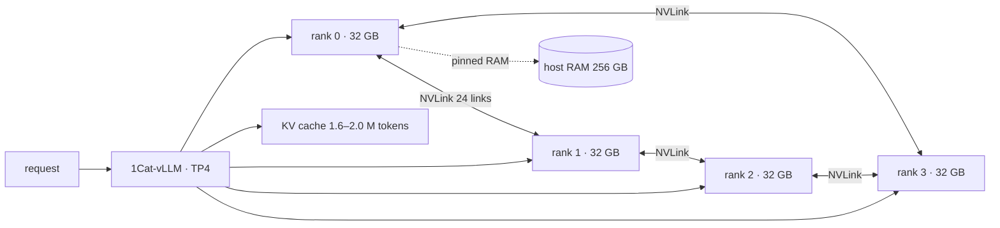

# 08 · 128 GB as one pool: 1Cat-vLLM 1.5.4, NVFP4 and speculative decoding

[Русский](../ru/08-1cat-vllm-nvfp4.md) · **EN** · [← README](../../README.md)

---

Until now the project treated llama.cpp + GGUF as the primary engine and kept 1Cat-LLM as
"the flagship for 27B". Practice — the [l2oot](https://www.youtube.com/@l2oot) channel
(seven videos on exactly this hardware) plus the engine's release notes — says otherwise:
for **NVFP4 checkpoints and speculative decoding** there is one path, 1Cat-vLLM, and it
delivers what GGUF cannot: **425 tok/s single-stream on a 27B** and **1139 tok/s across eight
concurrent requests** on four V100s.

Below: how to reproduce that on our machine, what to verify before any software, and where we
win over the author thanks to 256 GB RAM instead of his 62 GB.

---

## 1. What the rig must show before any software

Hardware acceptance happens **before** the engine goes in, otherwise you cannot tell what
broke. The whole list runs as one command: [`tools/verify-v100-node.sh`](../../tools/verify-v100-node.sh)
(`0` — node accepted, `1` — failures, `2` — not a GPU host).

| Check | Command | Expected |
|---|---|---|
| all four cards present | `nvidia-smi -L` | four `Tesla V100-SXM2-32GB` |
| NVLink alive | `nvidia-smi nvlink -s` | **all 24 entries `Active`** (4 cards × 6 links) |
| no link errors | `nvidia-smi nvlink -e` | zeros everywhere |
| topology | `nvidia-smi topo -m` | `NVx` between every pair, never `SYS`/`PHB` |
| PCIe tree | `lspci -tv \| grep -i nvidia` | four GPUs behind one PEX8748 bridge |
| temperature/clock | `nvtop`, `nvidia-smi dmon` | no throttling under load |

### The NVLink trap: sixteen screws, two full turns

The author had 14 of 24 links working. Drivers, BIOS, kernel parameters, a multimeter — nothing
helped. What did help was the sentence in the board's own manual: tighten every screw fully,
then **back out the 16 central screws exactly two full turns counter-clockwise**. After that,
24 of 24. It is about SXM2 module seating: an over-tightened screw bows the PCB and part of the
NVLink contacts lose proper contact.

Our rule: check links **before** closing the case, and again after every removal of a module.
Plus the LED self-check from the manual (section 5.6): with the host off all eight LEDs are lit
(standby power, normal); once powered, **all LEDs off** means modules are seated. One or two LEDs
still lit — power down, reseat that GPU.

### If PCIe errors appear

Symptoms: performance dips, `link retrain`, `PCIe AER` in `dmesg`. Per the board manual —
force the slot down to **PCIe 2.0 x16** in BIOS, keeping the width. Inference barely notices:
the bottleneck is NVLink and compute, not the host bus.

---

## 2. Software stack

| Layer | What | Why exactly this |
|---|---|---|
| OS | **Ubuntu Server 24.04 LTS, no GUI** | a desktop eats RAM and spawns processes; pinned memory for the model is scarce |
| Driver | `nvidia-driver-580-server` | the last branch with Volta (SM70) |
| CUDA | `cuda-toolkit-12-8` from NVIDIA's repo | CUDA 13 dropped Volta |
| Build | `ninja-build`, `g++` | the engine JIT-compiles some operators at startup |
| Libraries | glibc **≥ 2.38**, GLIBCXX **≥ 3.4.21** | wheel requirement; 24.04 ships 3.4.33 — plenty |
| Python | 3.12 (conda env `1cat-vllm-sm70_v1.5.4`) | the wheel is cp312 |
| Engine | wheel **1cat_vllm-1.5.4+cu128** | no source build needed |

```bash
sudo apt update
sudo apt install -y nvidia-driver-580-server nvtop ninja-build
# CUDA 12.8
wget https://developer.download.nvidia.com/compute/cuda/repos/ubuntu2404/x86_64/cuda-keyring_1.1-1_all.deb
sudo dpkg -i cuda-keyring_1.1-1_all.deb && sudo apt update && sudo apt install -y cuda-toolkit-12-8

# environment
conda create -y -n 1cat-vllm-sm70_v1.5.4 python=3.12
conda activate 1cat-vllm-sm70_v1.5.4
python -m pip install --upgrade pip setuptools wheel

# wheel + checksum ("+" in the URL is %2B)
BASE=https://github.com/1CatAI/1Cat-vLLM/releases/download/v1.5.4
wget "$BASE/1cat_vllm-1.5.4%2Bcu128-cp312-cp312-linux_x86_64.whl"
wget "$BASE/SHA256SUMS"
sha256sum --ignore-missing -c SHA256SUMS     # expect "OK"
python -m pip install --prefer-binary --no-cache-dir \
  --extra-index-url https://download.pytorch.org/whl/cu128 \
  ./1cat_vllm-1.5.4+cu128-cp312-cp312-linux_x86_64.whl
```

Checksums: wheel 292.7 MB, SHA256 `8f1e4d543764bc749eb95906651efffe0595e20a2ab57624b541542d452ddef1`
(verified against the release's `SHA256SUMS`). 1.5.3 is available for rollback, same procedure.

Post-install check — versions and a live FlashAttention-V100:

```bash
python - <<'PY'
import sys, torch, vllm, flash_attn_v100
from flash_attn_v100 import flash_attn_grouped_verify_max_query_tokens
print("Python:", sys.version.split()[0], "| Torch:", torch.__version__, "| CUDA:", torch.version.cuda)
print("GPU:", torch.cuda.get_device_name(0), "| CC:", torch.cuda.get_device_capability(0))
print("vLLM:", vllm.__version__, "| flash_attn_v100:", flash_attn_v100.__version__)
print("DFlash2 grouped verify max Q:", flash_attn_grouped_verify_max_query_tokens())
PY
```

---

## 3. Models: what to download, what we already have

Revisions are pinned — the engine was validated on exactly these.

| Model | Repo | Size | Ours |
|---|---|---|---|
| **27B NVFP4** (target) | `unsloth/Qwen3.8-27B-NVFP4` | ~22 GB | ✅ downloaded |
| **DFlash2** (drafter) | `incoai/Qwen3.8-27B-DFlash2`, revision `dedf8df6` | ~3.6 GB | ✅ downloaded |
| **Flash-Next NVFP4** (256K) | `RadixArk/Qwen3.8-Flash-Next-NVFP4`, revision `7b719225…` | ~135 GB | ⬜ not yet |
| QUASAR variant 27B | `QUASAR-QAT/Qwen3.8-27B-QUASAR-NVFP4` | ~22 GB | ⬜ optional |

```bash
mkdir -p ~/models/incoai/Qwen3.8-27B-DFlash2
hf download incoai/Qwen3.8-27B-DFlash2 \
  --revision dedf8df68adfb1afeaf7b7480c0a0243108177b4 \
  --local-dir ~/models/incoai/Qwen3.8-27B-DFlash2
```

---

## 4. How four cards become one 128 GB pool

There is no "merging" into a single card: the model is split into four equal parts
(**tensor parallel = 4**), each rank computes its slice of every layer, and they exchange over
NVLink. To the model it is one 27B transformer; to the hardware it is four cards that agree on
every layer. That is why NVLink is not a bonus here but a precondition: without a live link
matrix the exchange falls back to PCIe and TP4 becomes slower than a single card.



27B NVFP4 layout across VRAM (per the author): weights **23.9 GiB** per card, KV cache **3.9**,
graphs **0.23**, ~4 GiB free. Flash-Next additionally carries a 47.7 GiB PLE table that does not
fit and lives in pinned host RAM.

**Our advantage.** The author ran this on 62 GB RAM and hit the allocator rounding a pinned block
up to a power of two (10.8 → 16 GiB × 4 workers = 64 GiB against 46 free) — hence his
`PLE-exact` patch. We have 256 GB: rounding is harmless, the patch is unnecessary, and the whole
PLE can stay in RAM (11.92 GiB per rank), which frees 4.48 GiB of VRAM for KV cache. That is not
"more speed" — it is **more context and more concurrency**.

---

## 5. Launch

### 27B NVFP4 + DFlash2 — maximum single-stream

```bash
vllm serve ~/models/unsloth/Qwen3.8-27B-NVFP4 \
  --served-model-name qwen3.8-27b-dflash2 --tensor-parallel-size 4 --dtype half \
  --attention-backend FLASH_ATTN_V100 --kv-cache-dtype int8_per_token_head \
  --max-model-len 262144 --gpu-memory-utilization 0.83 \
  --max-num-batched-tokens 4096 --max-num-seqs 8 --block-size 2048 --mamba-block-size 2048 \
  --enable-prefix-caching --partial-prefix-cache --mamba-cache-mode align \
  --mixed-prefill-step-latency-ms 0 --enable-prompt-tokens-details \
  --enable-auto-tool-choice --tool-call-parser qwen3_coder --reasoning-parser qwen3 \
  --default-chat-template-kwargs '{"enable_thinking":false}' --seed 0 --trust-remote-code \
  --speculative-config '{"method":"dflash","model":"/home/ka/models/incoai/Qwen3.8-27B-DFlash2",
    "num_speculative_tokens":7,"kv_cache_dtype":"auto","attention_backend":"FLASH_ATTN_V100",
    "draft_sample_method":"probabilistic","enforce_eager":false}'
```

### 27B NVFP4 + MTP4 — better on long context and multi-stream

Same command without a drafter (the MTP head is already inside the checkpoint):

```bash
  --speculative-config '{"method":"mtp","num_speculative_tokens":4}'
```

### Flash-Next — 256K context, MTP5 + DCP2

```bash
vllm serve ~/models/RadixArk/Qwen3.8-Flash-Next-NVFP4 \
  --served-model-name qwen3.8-flash-next-nvfp4 --tensor-parallel-size 4 \
  --decode-context-parallel-size 2 --dtype half --max-model-len 262144 \
  --max-num-batched-tokens 4096 --max-num-seqs 8 --attention-backend FLASH_ATTN_V100 \
  --enable-prefix-caching --partial-prefix-cache --block-size 2048 --mamba-block-size 2048 \
  --mixed-prefill-step-latency-ms 0 --enable-prompt-tokens-details \
  --enable-auto-tool-choice --tool-call-parser qwen3_coder --reasoning-parser qwen3 \
  --trust-remote-code --seed 0 --kv-cache-dtype float16 --gpu-memory-utilization 0.89 \
  --mamba-cache-mode align --mamba-ssm-cache-dtype float32 \
  --default-chat-template-kwargs '{"enable_thinking":false}' \
  --kernel-config '{"sm70_hcx":true,"sm70_qsa_prep":true,"sm70_hcx_local_schedule":true,
    "hc_weight_storage":"sharded","qsa_host_kv":true,
    "qsa_host_kv_dtype":"int8_per_token_head","qsa_host_kv_hot_dtype":"int8_per_token_head",
    "qsa_host_kv_hot_tokens":262144,"qsa_host_kv_prefill_stage_tokens":262144,
    "qsa_host_kv_trim_warmup_cache":true,"qsa_host_kv_state_blocks":176,
    "qsa_host_kv_history_blocks":768}' \
  --speculative-config '{"method":"mtp","model":"/home/ka/models/RadixArk/Qwen3.8-Flash-Next-mtp",
    "num_speculative_tokens":5,"draft_sample_method":"greedy"}'
```

⚠ The wheel ships `serve_flash_next_nvfp4_v100.sh` with the **old** configuration (MTP4, no DCP,
131K hot zone) — it will not reach these numbers, use the command above.

---

## 6. What we get (1.5.4, 4×V100-SXM2-32GB, TP4)

| Scenario | 27B · DFlash2 | 27B · MTP4 | Flash-Next |
|---|---:|---:|---:|
| single request, 8K | **425** tok/s | 281 | 202 |
| 8 concurrent, 8K | **1139** | 1264 | 810 |
| 8 concurrent, 64K | 784 | 916 | **979** |
| HumanEval, single | **541** | 367 | 337 |
| KV cache, tokens | 1.63 M | 1.99 M | 1.54 M |
| VRAM per card after start | 27.0 GiB | 26.3 | 29.2 |
| VRAM per card after tests | 30.4 GiB | 29.5 | 31.1 |
| host RAM free at start | 43 GiB | 45 | 15 |

Prefill (first token): 8K — 0.5 s; 32K — 5.8 s (Flash-Next) / 8.2 s (27B); 250K — 59 s / 113 s.
A repeated request with the same prefix takes 0.3–0.6 s instead of seconds: prefix caching is
what makes agent conversations fast, where every turn is "same context plus one reply".

**In human terms:** 425 tok/s is roughly 300–400 words of Russian per second, a page of code in
2–3 seconds, and an application generated within about a minute. The author writes code on this
and ships a game generated in a single request. A mainstream cloud chat does 40–90 tok/s on the
same tasks — **4–8× slower**, with limits and a subscription on top.

---

## 7. Risks of our platform and how to remove them

| Risk | Symptom | What we do |
|---|---|---|
| Atermiter does not expose MMIO for 4×32 GB BARs | sees 1–2 cards, code 12/43, POST hangs | **Above 4G Decoding = Enabled**, CSM = Disabled, slot in x16 without bifurcation; if it still fails, that is the board's limit — a server board is required (the author hit exactly this on a consumer Asus) |
| PCIe AER, retrain under load | `dmesg`, speed dips | set the slot to **PCIe 2.0 x16** in BIOS |
| NVLink not 24/24 | `nvlink -s` | back out the 16 central screws two turns, check the seating LEDs |
| Air cooling at 4×300 W | closed case, high temps | `nvidia-smi -pl 250`, strong airflow, `dmon`; water gives 59 °C at 40 °C coolant — air will sit at 70–80 °C, which is fine, throttling starts higher |
| Power | per the V2.10 manual **4× PCIe 8-pin, all mandatory**; our variant has two inputs — check the silkscreen | two 6+2 per input, grounded socket/PDU, no household splitters |
| Hot-plugging SXM2 | — | forbidden outright, only while de-energised |

---

## 8. What the guides get wrong, and where our data differs

| In the sources | Ours / reality |
|---|---|
| "PEX8749" | the board manual says **Broadcom PEX8748 Gen3, 48 lanes** |
| "GLIBCXX ≥ 3.4.30" (our earlier note) | the engine requires **≥ 3.4.21**; Ubuntu 24.04 ships 3.4.33 |
| videos recorded on 1.5.1, 173–384 tok/s | on 1.5.4 the same scenarios give 202–425 tok/s |
| "the PLE-exact patch is required or you get OOM" | that is about 62 GB RAM; on 256 GB it is unnecessary |
| 62 GB RAM, 28 cores at the author's | we have 256 GB and 72 threads — headroom for KV/PLE and hybrid mode |
| the Windows path (TCC→WDDM, GRID) | not our scenario, kept as reference only |

---

## 9. Sources

- Videos: [Flash-Next + MTP4](https://youtu.be/_ORkPu09QH8), [full 27B NVFP4 + DFlash2 guide](https://youtu.be/CUuGClNNjdg),
  [4×V100 on water](https://youtu.be/wKQh1qJ6TB8), [27B on one card](https://youtu.be/xTiM_fo4Eao),
  [two cards won't boot](https://youtu.be/iyTtzPSiMUc), [V100 in Windows](https://youtu.be/-fzEbQbxVuw),
  [what arrived from China](https://youtu.be/ue841XfF8xM).
- Author's instructions: [27B NVFP4 + DFlash2](https://t.me/l2oot_AI/28), [Flash-Next + MTP4](https://t.me/l2oot_AI/30).
- Board manual `V100-SXM2-NVLINK_D V2.10` (v1.1 RU) — sections 5.5–5.7, 6.1–6.2.
- [1Cat-vLLM](https://github.com/1CatAI/1Cat-vLLM), release **v1.5.4** (commands, numbers, limitations).
- PR [vllm#59848](https://github.com/vllm-project/vllm/pull/59848) — pinned-memory rounding (the 1.5.1 patch history).

#local-llm #v100 #nvfp4 #vllm #1cat #speculative-decoding #sxm2 #nvlink
