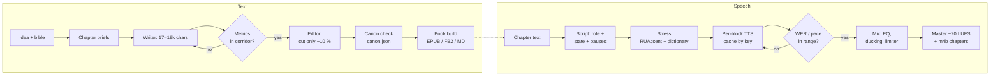

# 09 · Writing a book and voicing it with local AI

**EN** · [Русский](../ru/09-books-writing-and-voicing.md) · [← README](../../README.md)

<p align="center">
  
  
  
  
</p>

**Sections:** [Short version](#short-version) · [Two pipelines](#two-pipelines) · [Writing](#writing-what-works) ·
[Writing models](#writing-models-for-128-gb) · [TTS engines](#tts-engines) · [Casting](#casting-23-roles-without-borrowed-voices) ·
[Mastering](#mastering-and-delivery) · [Download list](#download-list) · [Pitfalls](#pitfalls) · [Sources](#sources)

---

## Short version

Writing a book with a local model and voicing it with a local TTS are two different problems,
and neither is limited by "intelligence" — both are limited by **pipeline discipline**.

1. **Text.** What works is not "write me a novel" but: bible → chapter briefs → chapters of
   17–19k characters → machine metrics → an editor allowed to cut only. Without a bible the
   pipeline collapses around chapters 15–25 — a recurring report in public threads, not a scare story.
2. **Speech.** In 2026 no open model reads Russian prose like a professional narrator. The best
   available option is **VoxCPM2** (2B, 30 languages, 48 kHz, Apache-2.0): voice cloning plus
   Voice Design from a description, and the best Russian timbre similarity in its class (SIM 81.1),
   although its Russian WER is 3.6–5.2 % — one word in ~25 needs a gate.
3. **Emotion is data, not a volume knob.** The role markup must carry state (calm, angry, tired,
   whisper) and the engine receives it as a style instruction or a separate reference. Otherwise
   "expressiveness" means punctuation.
4. **You may not clone a narrator's voice.** Reference clips from commercial releases are someone
   else's recording and someone else's voice. Legal routes: Voice Design, synthetic voices,
   CC0 pools (Mozilla Common Voice), Golos (CC BY-SA).
5. **Verify by measurement.** WER on 1 % of blocks, f0 per role, seconds per character,
   LUFS/LRA. "The file exists" is not acceptance.

---

## Two pipelines



Two conclusions from that diagram are worth more than any model:

- **Text and speech are joined by one rule**: every line of dialogue carries an attribution —
  the speaker's name or a speech verb with gender. Then automatic role markup works instead of
  guessing. On our material the heuristic without that rule was wrong in **40 % of dialogue
  blocks** (195 of 488 on chapters 1–5), and book two needed **1,525 manual fixes**. That is a
  defect of the prose, not of the parser.
- **Prose and TTS need a layer between them** — `chNN.script.jsonl`:
  `{block, role, state, normalised text, pause}`. TTS must not parse fiction: numbers as words,
  abbreviations, stress marks and the attribution cut out of the line are prepared once and cached.

---

## Writing: what works

**What does not:** "write a 600k-character novel" (models cannot count — RL approaches such as
LongWriter-Zero, [arXiv 2506.18841](https://arxiv.org/abs/2506.18841), beat SFT precisely on
length control); one long chat for a whole book (context drifts after 15–25 chapters); and
self-critique in the same context (the model defends its own text).

**What does:**

| Technique | Why | Check |
|---|---|---|
| **Bible + chapter briefs** | the writer reads the world instead of recalling it | a brief contradicting the bible is an error before generation |
| **Fan-out over chapter ranges** (4 per writer) | parallelism without canon races | completeness by numbers + `wc -m` |
| **Reveal table** (who knows what by chapter N) | stops an omniscient hero | manual pass + `canon_check.py` |
| **Style retriever**: 3–5 passages per scene type from the author's corpus | keeps the voice, not "smooth LLM prose" | mean sentence length, dialogue share, punch lines |
| **Editor allowed to cut only** (−10 %) | removes the water a writer will not cut from himself | characters before/after, scenes preserved |
| **Weighted passes** (scene 35 %, arc 25 %, cliché 15 %, dialogue 15 %) | not one giant "polish everything" | one report per pass |
| **Metrics as a gate, not a report** | an out-of-corridor chapter never reaches the build | chars, scenes, dialogue share, system lines |

Volume corridor for an Atamanov-style book: 600k ±25k characters, 33±4 chapters of 16–23k,
one system line per ~3.8k characters. That doubles as the gate.

---

## Writing models for 128 GB

Everything fits whole; pairs of small models coexist. Volta matters: **no bf16**, fp16 only,
and some newer inference stacks require CC ≥ 7.5 and will not run — see [Engines](03-engines.md).

| Job | Model | Size | Why |
|---|---|---|---|
| Main writer | **Qwen3.8-27B** (Apache-2.0) | Q5/Q8 · 20–29 GB | best intelligence/speed, 256K context, strong Russian |
| Uncensored writer (horror, grey) | **Huihui-Qwen3.8-27B-abliterated** | Q8 · 29 GB | same quality, no moralising |
| Heavy editor / arc | **Qwen2.5-72B-Instruct** or abliterated | Q6 · 62 GB | mature Russian, long edits |
| Agentic line (canon, checklists) | **GLM-4.5-Air** (110B/12B MoE) | Q5 · 83 GB | tool calling, planning |
| Prose in other voices | **Hermes-4-70B**, Magnum, Miqu | Q4–Q5 · 40–70 GB | variety across the fan-out |
| Style retrieval | **Qwen3-Embedding-4B** | Q8 · 4.5 GB | RAG over the author's corpus |
| Fast draft | **GPT-OSS-20B** / Qwen3-8B | 7–12 GB | draft and throw away |

Rule of thumb: **the writer and the editor are different models.** One model both writes and
praises; swap the model for editing and the water becomes visible immediately.

---

## TTS engines

Data from model cards and public benchmarks; our own measurement is marked ✅.

| Engine | Russian | Emotion | Audio | VRAM | Licence | Verdict |
|---|---|---|---|---|---|---|
| **VoxCPM2** (OpenBMB, 2B) | 30 languages; ru WER 5.21 (CV3) / 3.63 (MLS); **SIM 81.1, best in class** | Voice Design from a description + style guidance while cloning | **48 kHz** | ~8 GB, RTF ~0.3 (4090) | **Apache-2.0** | **primary candidate** |
| **Qwen3-TTS-1.7B** | 10 languages, ru WER 3.21, but stress complaints | voice description, 3-s cloning | 24 kHz | ~4.8 GB | Apache-2.0 | second candidate, check stress |
| **Fish Audio S2** (4B) | ru WER 2.4–2.8, best intelligibility | yes | 24–44 kHz | ~10 GB | open weights | intelligibility candidate |
| **TeraTTSv2** | Russian-native, **automatic stress** (RUAccent, MIT); ✅ WER **1.8 %** on 9 phrases (CPU, 44.1 kHz), names and numbers read correctly | 10 voice styles | **44.1 kHz** | ONNX, **CPU** | OpenRAIL-M + attribution (**commercial OK**) | stress safety net, runs without a GPU |
| **F5-TTS_RUSSIAN** | best Russian clone | via per-mood references | 24 kHz | ~4 GB | **CC BY-NC 4.0** | non-commercial only |
| **XTTS v2** | present, audible accent | via reference | 24 kHz | ~2.5 GB | CPML (non-commercial) | already on the box, fallback |
| **Chatterbox Multilingual** | 23 languages, accent audible | `exaggeration` 0–1 | 24 kHz | 4–6 GB | MIT | drafts only |
| **CosyVoice 3** | 9 languages, Chinese accent without a reference transcript | instruct | 24 kHz | 2–3 GB | Apache-2.0 (check weights) | not for RU untuned |
| **Silero** | Russian-native | none | 48 kHz | CPU | CC BY-NC-SA | flat but solid |
| **edge-tts** | best "neutral" Russian by ear | none | 24 kHz | 0 | unofficial endpoint, no publication rights | canary, not a base |

What this changes versus "just take Chatterbox":

- **Russian timbre similarity depends on cloning quality, not on the number of languages.**
  VoxCPM2 scores SIM ru 81.1 against 67.6 for ElevenLabs and 79.0 for Fish S2 — from a 2B model.
- **48 kHz versus 24 kHz** is not cosmetics: after mixing and mastering a 24 kHz bed audibly
  "sands" on sibilants.
- **Voice Design removes the casting rights problem**: a voice is described in words
  ("45-year-old man, low, tired, speaks in short sentences"), not cloned from someone's recording.

---

## Casting 23 roles without borrowed voices

Three legal sources of timbre:

1. **Voice Design** (VoxCPM2, Qwen3-TTS) — pin the seed and the description in
   `cast/voices.json` so a voice does not drift between volumes.
2. **CC0 pool** — Mozilla Common Voice ru: clean 8–12 s clips with a passport (gender, age,
   manner). Cloning CC0 material is lawful and needs no attribution.
3. **Synthetic references** — generate 20 distinct voices once and clone those: identical across
   all volumes, zero rights questions.

Casting rules learned on 23 roles:

- Adjacent voices differ by **3–5 Hz in f0** and 3–5 % in pace; less and they merge.
- One voice, one character, for the whole series. A new volume never re-casts the Boatswain.
- Unnamed characters (concierge, duty officer, courier) share 2–3 voices but **never appear in
  the same scene**.
- A child's voice is a separate timbre, not "female at +16 % pace".

States passed to the engine: `calm`, `tense`, `angry`, `tired`, `whisper`, `system` — each mapped
to a style instruction (VoxCPM2/Qwen3-TTS) or to a dedicated reference (XTTS/F5). The source is
the prose itself: speech verbs, caps, `!`, `…`, plus one model pass over the chapter that sees the
whole scene. Stored in `cast/`, edited by hand, cached.

---

## Mastering and delivery

| Parameter | Value | Why |
|---|---|---|
| Loudness | **−20 LUFS**, peak −3 dBTP | phone and headphones; the 1C reference is −21.5 |
| LRA | measure, keep ≤ 10 | higher reads as flat dynamics |
| Format | mono 44.1 kHz, 96–128 kbps | voice, not music |
| Delivery | **m4b with chapters** + per-chapter mp3 | one file, bookmarks, Audiobookshelf |

Chapters go into m4b as metadata, no re-encoding:

```bash
# chapters.txt: [CHAPTER] / TIMEBASE=1/1000 / START=… / END=… / title=…
ffmpeg -i book.mp3 -i chapters.txt -map_metadata 1 -map_chapters 1 -c:a copy book.m4b
```

Acceptance is three measurements, not "the file exists":

1. **WER** on 1 % of blocks via `faster-whisper` (large-v3 on V100: **15.2× real time**, 4.4 GB
   VRAM); threshold < 5 %.
2. **f0 per role** — male 106–138 Hz, female 157–181 Hz, 3–5 Hz spacing.
3. **Pace** — characters per second within ±15 % of the chapter median; a dropped chunk shows
   up instantly.

---

## Download list

Weights go to a **separate NVMe, never to the root filesystem**: `/srv/apps/models`
(954 GB, 642 GB free, btrfs with zstd:1). Set `HF_HOME=/srv/apps/models/hf` — otherwise 23 GB of
weights head for `/`, where 20 GB are free, and the download dies halfway.

For this build (4×V100 = 128 GB, fp16, no bf16):

```bash
# --- writing ---
hf download Qwen/Qwen3.8-27B                                  # main writer
hf download huihui-ai/Qwen3.8-27B-abliterated                 # uncensored creative
hf download Qwen/Qwen2.5-72B-Instruct                         # heavy editor
hf download zai-org/GLM-4.5-Air                               # agentic line (canon, checklists)
hf download Qwen/Qwen3-Embedding-4B                           # RAG over the author's corpus

# --- speech ---
pip install voxcpm && hf download openbmb/VoxCPM2              # 2B, 48 kHz, Voice Design
hf download Qwen/Qwen3-TTS-12Hz-1.7B-Base                      # second voice, description control
hf download TeraSpace/TeraTTSv2                                # ONNX, auto stress, commercial
hf download Misha24-10/F5-TTS_RUSSIAN                          # RU clone, NON-COMMERCIAL only
pip install ruaccent                                           # stress marking, CPU

# --- verification ---
hf download openai/whisper-large-v3                            # WER gate
```

One venv per engine: VoxCPM2 and Qwen3-TTS disagree on torch versions, and breaking a working
TTS server in the middle of a volume render is the most expensive kind of regression.

---

## Pitfalls

- **V100 and TTS.** Volta (sm70) needs a torch build with sm70 kernels; some "V100" images ship
  without them and fail on the first tensor. This is the **only exception** to "llama.cpp and
  1Cat-vLLM only": LLM inference never touches torch, while TTS and Whisper only run on it —
  so the PyTorch stack is installed separately and scoped to the creative layer
  (see [Engines](03-engines.md)). Check before downloading weights:
  `python -c "import torch;print(torch.cuda.get_device_capability())"` → `(7, 0)`, then one short
  synthesis.
- **No bf16 on Volta.** Wherever a model asks for bf16, use fp16 and watch for NaN — diffusion TTS
  (VoxCPM2) is numerically touchier than an LLM.
- **Voice Design is unstable between runs.** The model itself says 1–3 attempts; pin the seed and
  keep the accepted take.
- **Borrowed voices.** Cloning a clip from a commercial release violates rights in both the voice
  and the recording. "A draft that will be replaced later" is not an excuse: drafts leak into
  releases.
- **A volume render takes 7–12 hours.** Run it outside the UI process (systemd unit) with a
  per-block cache and a watchdog that synthesises a real phrase, not `/health`.

---

## Conclusions

1. **A local book pipeline is not "a model" but five layers**: bible, briefs, writer, cutting
   editor, machine metrics. The model is third in importance.
2. **Liveliness comes from rhythm, not adjectives**: long analysis paragraph → one-line punch,
   dialogue with attributions, dry system lines. Measurable, not a matter of taste.
3. **For Russian speech in 2026 the best open choice is VoxCPM2** (48 kHz, Voice Design,
   Apache-2.0, best Russian timbre similarity), with RUAccent before synthesis and a WER gate
   after. It does not promise a 1C-grade narrator — it promises control, legality and zero cost.
4. **Role and emotion markup is data**, written once and reused across volumes. The saving is
   hundreds of manual fixes per book.
5. **128 GB of VRAM fits everything at once**: writer, editor, TTS, Whisper and embeddings live
   side by side, without a queue and without the cloud.

---

## Sources

- VoxCPM2: [GitHub](https://github.com/OpenBMB/VoxCPM), [weights](https://huggingface.co/openbmb/VoxCPM2), [technical report arXiv 2606.06928](https://arxiv.org/abs/2606.06928) — 30 languages, 48 kHz, Apache-2.0, SIM ru 81.1
- Qwen3-TTS: [model card](https://selfhost.directory/models/qwen/qwen3-tts-12hz-1.7b-customvoice); Russian criticism — [Habr discussion](https://habr.com/ru/companies/bothub/news/988110/comments/); ru WER 3.21 — [benchmark](https://github.com/odiak/Qwen3-TTS-MLX)
- TeraTTSv2: [HF](https://huggingface.co/TeraSpace/TeraTTSv2), [licence and run](https://selfhost.directory/models/teraspace/terattsv2) — OpenRAIL-M + attribution, RUAccent-based stress
- F5-TTS_RUSSIAN: [HF](https://huggingface.co/Misha24-10/F5-TTS_RUSSIAN) — CC BY-NC 4.0
- CosyVoice 3 and the Russian caveat: [reality check](https://www.banandre.com/blog/alibaba-cosyvoice-3-production-tts-voice-cloning-reality-check); [repo](https://github.com/goanpeca/CosyVoice)
- Chatterbox Multilingual (23 languages, `exaggeration`): [Vast.ai](https://vast.ai/model/chatterbox), [HF](https://huggingface.co/theo77186/chatterbox-f16-sf)
- RUAccent (0.82 vs 0.38 for silero): [COLING 2025](https://aclanthology.org/2025.coling-main.444.pdf)
- Whisper large-v3 on V100 — 15.2× real time: [measurement](https://store.agilesoftware.pl/en/blog/whisper-polish-gpu)
- LongWriter-Zero (RL vs SFT on long text): [arXiv 2506.18841](https://arxiv.org/abs/2506.18841)
- Story-bible loop, collapse around chapters 15–25: [r/WritingWithAI digest](https://www.automateed.com/how-to-keep-an-ai-generated-book-consistent-reddit)
- Weighted editing passes (scene/arc/cliché/dialogue): [chapter-drafter](https://github.com/jwynia/agent-skills/blob/main/skills/creative/fiction/orchestrators/chapter-drafter/SKILL.md)
- Style LoRA and separating style from content: [EDITORS](https://ssa.hal.science/I2M-2014-/hal-05767581v1)
- m4b chapters via ffmpeg: [example](https://github.com/borewit/music-metadata/blob/a96504b9e7a1874ac527ef730c6e4c23e3ef42f9/test/samples/mp4/chapters-fixtures.md)
- V100 TTS practice (RTF 1.30 → 0.62, fp16 traps): [write-up on 3×V100](https://k2archer.github.io/2026/11/05/TTS/V100%E6%B5%81%E5%BC%8FTTS%E6%80%A7%E8%83%BD%E4%BC%98%E5%8C%96%E5%AE%9E%E8%B7%B5/)

---

`#local-llm #v100 #tts #audiobook #llm-writing #voxcpm #ruaccent #selfhosted`
