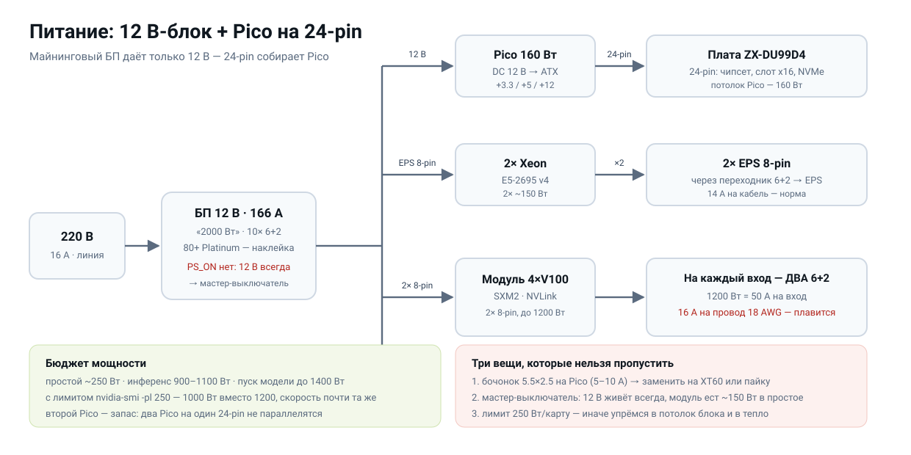

# 07 · Сборка и запуск: пошаговый мануал

**RU** · [English](../en/07-build-and-launch.md) · [← README](../../README.md)

---

Этот документ — рабочая инструкция от коробок до первого токена. Всё, что можно проверить
командой, оформлено командой с ожидаемым выводом: если вывод другой — не идём дальше, чиним.

## 0. Конфигурация записи (20.11.2026)

| Компонент | Что именно | Статус |
|---|---|---|
| GPU | **4× Tesla V100 SXM2 32GB** на одной несущей плате с полным NVLink, коммутатор Broadcom PEX8749, выход — **один PCIe 3.0 x16**, питание **2× 8-pin до 1200 Вт** | куплено |
| Материнская плата | **Atermiter X99 Dual X99** (линейка ZX-DU99D4), E-ATX, чипсет C612, 2× LGA2011-3, 8× DDR4 DIMM, 2× M.2 NVMe | куплено |
| CPU | **2× Intel Xeon E5-2695 v4** — 18 ядер / 36 потоков, 2.1–3.3 ГГц, 45 МБ L3, 120 Вт, 40 линий PCIe 3.0, DDR4-2400 | куплено |
| RAM | **256 ГБ = 8× 32 ГБ DDR4-2400 REG ECC (RDIMM 2Rx4)**, 1 DIMM на канал, 76.8 ГБ/с на сокет | купить |
| БП | **12 В-only «2000 Вт» (12V/166A, 10× 6+2)** + **2× PICO-BOX 12V→ATX 160 Вт**: 24-pin платы — через Pico, CPU EPS и модуль — прямо с 12 В | куплено |
| Диск | NVMe M.2, 2 ТБ | куплено |
| Охлаждение | 2× кулер LGA2011-3 (квадратный ILM), продув корпуса от 3× 140 мм | купить/проверить |
| ОС | Ubuntu 24.04 LTS | — |

Суммарные ожидания по питанию: простой ~250 Вт (модуль V100 не умеет экономить, ~42 Вт на карту),
нагрузка 900–1100 Вт, пик на старте модели до 1400 Вт.

## 1. До сборки

- Кулеры под LGA2011-3 должны быть с **квадратным креплением (Square ILM)**. Узкий Narrow ILM
  на эту плату не встанет.
- Все 8 планок RAM — **одна модель, один ранг (2Rx4)**. Смесь Samsung/Hynix/Micron разного ранга
  на китайских dual-X99 — самая частая причина «плата не стартует».
- Модуль V100 берём **только за текстолит несущей платы**, не за радиаторы и не за мостовую
  плату NVLink. Не разбираем: SXM2-прижим на заводе откалиброван.
- Заранее приготовить: термопасту, отвёртку с динамометрическим наконечником (или аккуратные руки),
  стяжки, ИБП.

## 2. Порядок сборки

### 2.1 Процессоры и кулеры

1. Открыть сокеты, вложить CPU по треугольнику-метке, закрыть рамку, опустить рычаги.
2. Паста — горошина в центр, кулер ставим крест-накрест: два винта на 2 оборота, потом
   противоположные до упора. Пружинные винты LGA2011-3 затягиваются до контакта, без фанатизма.
3. Разъёмы питания CPU — **оба 8-pin EPS**, даже если стартует с одним.

### 2.2 Память

1. Сначала полностью заполняем **CPU1**: 4 планки в 4 канала (слоты обычно подписаны, крайние
   от сокета — первые). Потом то же для **CPU2**.
2. При одном процессоре половина слотов и часть PCIe мертвы — у нас два, поэтому все 8 рабочих.
3. Проверить, что защёлки закрылись с обеих сторон и планка стоит ровно.

### 2.3 Модуль V100

1. Ставим в **PCIe x16 на стороне CPU1** (обычно верхний слот).
2. Питание модуля — **2× 8-pin, и на каждый вход идёт по ДВА кабеля 6+2** (параллель). Модуль
   тянет до 1200 Вт: это ~50 А на вход, а в одном 6+2 всего три провода 12 В — 16 А на провод
   18 AWG, которые греются и плавятся. См. 2.5.
3. Модуль длинный и тяжёлый — обязательно подпереть или закрепить, провисание слота ломает контакт.

### 2.4 Первый старт

Первый запуск — **без модуля V100**: проверяем плату, два CPU и всю память. Модуль ставим,
когда система стабильно грузится и видит 256 ГБ.

### 2.5 Питание: 12 В-БП + Pico на 24-pin

<p align="center">
  
</p>


Блок питания здесь — майнинговый, **12 В-only** (166 А, 10 разъёмов 6+2), 24-pin у него нет.
Штатный ATX для платы собирает PICO-BOX (вход DC 12 В, выход ATX 24-pin до 160 Вт).

| Потребитель | Откуда | Кабель |
|---|---|---|
| 24-pin платы | Pico #1 | 24-pin в плату; 12 В на вход Pico |
| 2× CPU EPS 8-pin | БП напрямую | 2× переходник `6+2 → EPS 8-pin` |
| Модуль V100, входы 1 и 2 | БП напрямую | на каждый вход **два** 6+2 |
| NVMe | Pico (+3.3 В) | — |
| Pico #2 | запас | **не параллелить** с первым |

Четыре правила, нарушение которых стоит железа:

1. **Один 6+2 ≈ 150 Вт потолок.** Питание модуля — двумя кабелями на каждый вход.
2. **У этого БП нет PS_ON**: 12 В живёт постоянно, модуль V100 под напряжением всегда (~150 Вт в
   простое). Ставим мастер-выключатель или умную розетку в разрыв 220 В.
3. **Бочонок 5.5×2.5 на входе Pico** рассчитан на 5–10 А, а нужно до 13 А → заменить на XT60/пайку
   или завести 12 В отдельным проводом с 6+2.
4. **Лимит GPU 250 Вт/карту** (`nvidia-smi -pl 250`, см. §4): 1000 Вт вместо 1200, суммарно ~1400 Вт —
   это и есть запас для блока с наклейкой «2000 Вт Platinum» за 2 712 ₽.

Если на плате ZX-DU99D4 есть отдельный **6-pin PCIe для слота** — питаем слот от БП, не через 24-pin:
тогда Pico несёт только 3.3/5 В (~40 Вт) и его 160 Вт становятся запасом.

## 3. BIOS: чек-лист

| Параметр | Значение | Зачем |
|---|---|---|
| Boot mode | **UEFI only**, CSM — Disabled | иначе часть карт и NVMe не поднимется |
| **Above 4G Decoding** | **Enabled** | без него карты с 32 ГБ памяти не видны системе |
| **Re-Size BAR** | Enabled | если плата глючит с ним — выключить и проверить P2P отдельно |
| IOMMU | Enabled | нужен для виртуалок; при проблемах с P2P — Disabled |
| PCIe speed | Gen3 / Auto | V100 — PCIe 3.0, выше не умеет |
| **Node Interleaving** | **Disabled** | иначе память склеивается в один узел и теряется NUMA-локальность |
| Memory frequency | 2400 (или Auto) | выше 2400 контроллер E5 v4 не умеет |
| Restore on AC loss | Power On | сервер должен подниматься сам |
| Fan control | Performance / Full | 1200 Вт GPU в одном корпусе |
| Secure Boot | Disabled | проще с DKMS-драйвером NVIDIA |

## 4. ОС и драйвер

```bash
sudo apt update
sudo apt install -y build-essential dkms linux-headers-$(uname -r) \
                    pciutils numactl hwloc lm-sensors
sudo apt install -y nvidia-driver-580-server
sudo reboot
```

580.x — последняя ветка с поддержкой Volta (SM70). Не обновляемся «на всякий случай»: CUDA 13 и
новые драйверы Volta уже не поддерживают.

### 4.1 Проверки после загрузки

```bash
nvidia-smi
```

Ожидаемо: **4× Tesla V100-SXM2-32GB, по 32768 MiB**, драйвер 580.x, CUDA 12.8.

```bash
nvidia-smi topo -m
```

Ожидаемо: между GPU — `NV4`/`NV6` (NVLink), между GPU и CPU — `SYS`.
Если между картами `SYS` — модуль сел в слот, у которого нет P2P, или мост NVLink не поднялся.

```bash
nvidia-smi nvlink -s     # 6 линков на каждую карту, status active
nvidia-smi nvlink -e     # счётчики ошибок: должны быть нули
numactl --hardware       # 2 узла, по 128 ГБ, локальность
```

```bash
sudo dmidecode -t memory | grep -E 'Size: [0-9]|Speed|Rank'
```

Ожидаемо: 8 планок по 32768 MB, **Speed: 2400 MT/s**. Если 2133 — BIOS не поднял частоту,
лечится выставлением вручную (у части ревизий DU99D4 частота памяти только автоматическая).

### 4.2 Настройки производительности

```bash
sudo nvidia-smi -pm 1              # persistence mode
sudo nvidia-smi -pl 250            # лимит на карту: пик падает с 1400 до ~1000 Вт
```

Лимит 250 Вт почти не стоит производительности на инференсе, но заметно спасает питание и
температуру.

## 5. Стресс-тест перед работой

```bash
git clone https://github.com/wilicc/gpu-burn && cd gpu-burn
make COMPUTE=70
./gpu_burn 300
```

Критерии приёмки: все 4 карты держат нагрузку, температура ≤ 85 °C, частоты не проваливаются
в пол, ошибок нет. После — снова `nvidia-smi nvlink -e`: нули.

## 6. llama.cpp под SM70

```bash
git clone https://github.com/ggml-org/llama.cpp && cd llama.cpp
cmake -B build -DGGML_CUDA=ON -DCMAKE_CUDA_ARCHITECTURES=70
cmake --build build -j$(nproc)
```

```bash
./build/bin/llama-bench --list-devices     # ожидаем 4 CUDA-устройства
```

### 6.1 Режим «всё в VRAM»

```bash
./build/bin/llama-server \
  -m /models/model-Q4_K_M.gguf \
  -ngl 99 -sm row --tensor-split 1,1,1,1 \
  -c 16384 -fa -ctk q8_0 -ctv q8_0 \
  -t 36 --numa distribute \
  --host 0.0.0.0 --port 8080 --api-key "$LLM_KEY"
```

- `-sm row` — row-split, который едет по NVLink; без живой NVLink это медленно.
- `-fa` включает flash attention, `-ctk/-ctv q8_0` экономит VRAM под контекст.
- `-t 36` — по числу физических ядер двух E5-2695 v4. Не 72.

### 6.2 Гибрид: модель больше 128 ГБ

```bash
./build/bin/llama-server \
  -m /models/big-moe-Q4_K_M.gguf \
  -ngl 99 -sm row --tensor-split 1,1,1,1 \
  --n-cpu-moe 20 --no-mmap \
  -c 8192 -fa -ctk q8_0 -ctv q8_0 \
  -t 36 --numa distribute \
  --host 0.0.0.0 --port 8081
```

Подбор `--n-cpu-moe`: начинаем с 8 и поднимаем шагом 2, пока VRAM не заполнится на 90–95 %.
`--no-mmap` обязателен — иначе page cache на 256 ГБ RAM устраивает thrashing на моделях 200+ ГБ.

Ожидаемая скорость гибрида — это полоса памяти, делённая на байты, читаемые на токен:
DDR4-2400 в 8 каналах даёт ~110 ГБ/с реальных, значит MoE с ~11 ГБ активных весов в Q4
поедет на ~10 ток/с, а dense 70B в RAM — ~3 ток/с (и смысла в этом нет).

## 7. NUMA: где теряется половина скорости

Два сокета = две NUMA-ноды. Если поток читает память соседнего сокета, он идёт через QPI.

```bash
numactl --hardware                       # смотрим узлы и размеры
numactl --cpunodebind=0 --membind=0 ./build/bin/llama-server ...
```

Практика: либо один процесс с `--numa distribute` и `-t 36`, либо два процесса, прибитых
к разным узлам (`--cpunodebind=0/1`). Второй вариант быстрее, но требует двух портов и балансировки
снаружи.

## 8. Автозапуск (systemd)

`/etc/systemd/system/llama.service`:

```ini
[Unit]
Description=llama.cpp server (4x V100 SXM2)
After=network-online.target
Wants=network-online.target

[Service]
Type=simple
User=llm
Group=llm
WorkingDirectory=/srv/llm
Environment="LLM_KEY=changeme"
ExecStart=/srv/llm/llama.cpp/build/bin/llama-server \
  -m /models/model-Q4_K_M.gguf \
  -ngl 99 -sm row --tensor-split 1,1,1,1 \
  -c 16384 -fa -ctk q8_0 -ctv q8_0 \
  -t 36 --numa distribute \
  --host 0.0.0.0 --port 8080 --api-key ${LLM_KEY}
Restart=always
RestartSec=10
LimitMEMLOCK=infinity
OOMScoreAdjust=-500

[Install]
WantedBy=multi-user.target
```

```bash
sudo systemctl daemon-reload
sudo systemctl enable --now llama.service
journalctl -u llama.service -f
```

`LimitMEMLOCK=infinity` нужен для блокировки памяти при `--no-mmap`, иначе ядро вытеснит веса.

## 9. Чек-лист приёмки

| Что проверяем | Ожидаемо | Команда |
|---|---|---|
| Карты видны | 4× V100-SXM2-32GB | `nvidia-smi` |
| Топология | NV4/NV6 между GPU | `nvidia-smi topo -m` |
| NVLink живой | 6 линков active | `nvidia-smi nvlink -s` |
| Ошибки NVLink | 0 | `nvidia-smi nvlink -e` |
| RAM | 256 ГБ, 2400 MT/s | `dmidecode -t memory`, `free -g` |
| NUMA | 2 узла по 128 ГБ | `numactl --hardware` |
| Питание | ≤ 1600 Вт под нагрузкой | `nvidia-smi -q -d POWER` |
| Температура | ≤ 85 °C | `nvidia-smi --query-gpu=temp.gpu --format=csv` |
| Модель в VRAM | 25–60 ток/с на 70B Q4 | `llama-bench -m ... -p 512 -n 128` |
| Гибрид | 5–25 ток/с на 120–235B MoE | `llama-server ... --n-cpu-moe N` |

## 10. Что делать, если

| Симптом | Причина | Лечение |
|---|---|---|
| Карт не видно вообще | Above 4G off / нет питания 8-pin / слот не на CPU1 | включить Above 4G, проверить кабели, переставить слот |
| Видна одна карта из четырёх | не поднялся PEX-коммутатор или NVLink-мост | перезатолкнуть модуль в слот, проверить прижим моста, питание |
| `nvidia-smi` висит | IOMMU/ACS мешает | выключить IOMMU в BIOS, перепроверить |
| Xid 79 (GPU fell off the bus) | просадка питания, перегрев, плохой контакт | лимит 250 Вт, продув, переподключить питание |
| `nvlink -e` не нули | прижим моста | переустановить мост/плату, повторить стресс |
| Видно меньше 256 ГБ | один CPU / не тот порядок слотов / разные планки | проверить второй CPU, порядок каналов, одинаковость модулей |
| Частота RAM 2133 | BIOS не поднял | выставить 2400 вручную, обновить BIOS под свою ревизию |
| Гибрид медленнее ожидаемого | mmap, NUMA, лишние потоки | `--no-mmap`, `--numa distribute`, `-t 36` |
| Модель падает по памяти | page cache / KV-кэш | `--no-mmap`, `-ctk q8_0 -ctv q8_0`, уменьшить `-c` |

## 11. Definition of done

Сборка считается готовой, когда одновременно выполнено:

1. `nvidia-smi` показывает 4 карты по 32 ГБ, `topo -m` — NVLink между ними.
2. `nvlink -e` — нули после 5 минут gpu_burn.
3. `free -g` — 251+ ГБ, `dmidecode` — 2400 MT/s на всех 8 планках.
4. Модель 70B Q4 отвечает с 25+ ток/с.
5. Модель 120B+ MoE отвечает в гибридном режиме, VRAM занята на 90–95 %.
6. `systemctl status llama` — active, поднимается после перезагрузки.

---
#local-llm #v100 #sxm2 #build #manual #numa
