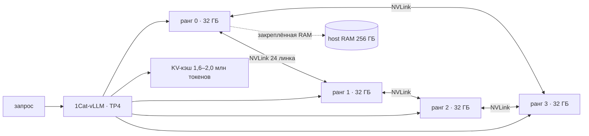

# 08 · 128 ГБ единым пулом: 1Cat-vLLM 1.5.4, NVFP4 и спекулятивное декодирование

**RU** · [English](../en/08-1cat-vllm-nvfp4.md) · [← README](../../README.md)

---

До этого документа проект считал основным движком llama.cpp + GGUF, а 1Cat-LLM держал
«флагманом для 27B». Практика (канал [l2oot](https://www.youtube.com/@l2oot), семь видео
про ровно это железо, плюс релиз-ноты движка) показывает: для **NVFP4-чекпойнтов и
спекулятивного декодирования** путь один — 1Cat-vLLM, и он даёт то, чего GGUF не даст:
**425 ток/с на 27B одиночным потоком** и **1139 ток/с на восьми одновременных** на четырёх
V100.

Здесь — как это повторить на нашей машине, что проверять до софта и где мы выигрываем
у автора за счёт 256 ГБ RAM вместо его 62 ГБ.

---

## 1. Что должен показать стенд до всякого софта

Приёмка железа идёт **до** установки движка, иначе непонятно, что виновато. Весь список ниже
проверяется одной командой: [`tools/verify-v100-node.sh`](../../tools/verify-v100-node.sh)
(`0` — узел принят, `1` — отказы, `2` — не GPU-хост).

| Проверка | Команда | Норма |
|---|---|---|
| все 4 карты видны | `nvidia-smi -L` | четыре `Tesla V100-SXM2-32GB` |
| линки NVLink живы | `nvidia-smi nvlink -s` | **все 24 записи `Active`** (4 карты × 6 линков) |
| ошибок на линках нет | `nvidia-smi nvlink -e` | нули по всем счётчикам |
| топология | `nvidia-smi topo -m` | между всеми парами `NVx`, нигде `SYS`/`PHB` |
| дерево PCIe | `lspci -tv \| grep -i nvidia` | четыре GPU под одним мостом PEX8748 |
| температура/частота | `nvtop`, `nvidia-smi dmon` | без троттлинга под нагрузкой |

### Ловушка NVLink: 16 винтов на два оборота

У автора из 24 линков работали 14. Ни драйверы, ни BIOS, ни прозвонка не помогли.
Помогло то, что написано в комплектной инструкции к плате: затянуть все винты до упора,
затем **ослабить 16 центральных винтов ровно на два полных оборота против часовой**.
После этого — 24 из 24. Это про прижим SXM2-модуля к разъёму: перетянутый винт выгибает
плату и часть контактов NevadaLink остаётся без нормального контакта.

Правило для нас: линки проверяются **до** сборки корпуса, и после каждого снятия/установки
модуля. Плюс самопроверка по светодиодам платы (см. мануал, раздел 5.6): при выключенном
хосте все 8 светодиодов горят — норма (дежурное питание), после включения **все погасли** —
модули прижаты. Горит один-два — этот GPU снимать и ставить заново.

### Если посыпались ошибки PCIe

Симптом: провалы скорости, `link retrain`, `PCIe AER` в `dmesg`. По мануалу платы —
в BIOS ограничить слот до **PCIe 2.0 x16**, оставив ширину. На инференс это влияет мало:
узкое место — NVLink и вычисления, а не хост-шина.

---

## 2. Софт-стек

| Слой | Что | Почему именно так |
|---|---|---|
| ОС | **Ubuntu Server 24.04 LTS без графики** | GUI ест RAM и процессы; закреплённая память под модель — дефицит |
| Драйвер | `nvidia-driver-580-server` | последняя ветка с Volta (SM70) |
| CUDA | `cuda-toolkit-12-8` из репозитория NVIDIA | CUDA 13 Volta не поддерживает |
| Сборка | `ninja-build`, `g++` | движок компилирует часть операторов на старте |
| Библиотеки | glibc **≥ 2.38**, GLIBCXX **≥ 3.4.21** | требование колеса; 24.04 даёт 3.4.33 — с запасом |
| Python | 3.12 (окружение conda `1cat-vllm-sm70_v1.5.4`) | колесо собрано под cp312 |
| Движок | колесо **1cat_vllm-1.5.4+cu128** | ставится без сборки из исходников |

```bash
sudo apt update
sudo apt install -y nvidia-driver-580-server nvtop ninja-build
# CUDA 12.8
wget https://developer.download.nvidia.com/compute/cuda/repos/ubuntu2404/x86_64/cuda-keyring_1.1-1_all.deb
sudo dpkg -i cuda-keyring_1.1-1_all.deb && sudo apt update && sudo apt install -y cuda-toolkit-12-8

# окружение
conda create -y -n 1cat-vllm-sm70_v1.5.4 python=3.12
conda activate 1cat-vllm-sm70_v1.5.4
python -m pip install --upgrade pip setuptools wheel

# колесо + контроль суммы (имя с «+» в URL кодируется как %2B)
BASE=https://github.com/1CatAI/1Cat-vLLM/releases/download/v1.5.4
wget "$BASE/1cat_vllm-1.5.4%2Bcu128-cp312-cp312-linux_x86_64.whl"
wget "$BASE/SHA256SUMS"
sha256sum --ignore-missing -c SHA256SUMS     # ждём «OK»
python -m pip install --prefer-binary --no-cache-dir \
  --extra-index-url https://download.pytorch.org/whl/cu128 \
  ./1cat_vllm-1.5.4+cu128-cp312-cp312-linux_x86_64.whl
```

Контрольные суммы: колесо 292,7 МБ, SHA256 `8f1e4d543764bc749eb95906651efffe0595e20a2ab57624b541542d452ddef1`
(сверено с `SHA256SUMS` на релизе). Для отката есть 1.5.3 — ставится тем же способом.

Проверка после установки — версии и живой FlashAttention-V100:

```bash
python - <<'PY'
import sys, torch, vllm, flash_attn_v100
from flash_attn_v100 import flash_attn_grouped_verify_max_query_tokens
print("Python:", sys.version.split()[0], "| Torch:", torch.__version__, "| CUDA:", torch.version.cuda)
print("GPU:", torch.cuda.get_device_name(0), "| CC:", torch.cuda.get_device_capability(0))
print("vLLM:", vllm.__version__, "| flash_attn_v100:", flash_attn_v100.__version__)
print("DFlash2 grouped verify max Q:", flash_attn_grouped_verify_max_query_tokens())
PY
```

---

## 3. Модели: что качать, что уже лежит

Ревизии пиним — движок тестировался именно на них.

| Модель | Репозиторий | Размер | У нас |
|---|---|---|---|
| **27B NVFP4** (цель) | `unsloth/Qwen3.8-27B-NVFP4` | ~22 ГБ | ✅ уже скачано |
| **DFlash2** (драфтер) | `incoai/Qwen3.8-27B-DFlash2`, ревизия `dedf8df6` | ~3,6 ГБ | ✅ уже скачано |
| **Flash-Next NVFP4** (256K) | `RadixArk/Qwen3.8-Flash-Next-NVFP4`, ревизия `7b719225…` | ~135 ГБ | ⬜ не качали |
| QUASAR-вариант 27B | `QUASAR-QAT/Qwen3.8-27B-QUASAR-NVFP4` | ~22 ГБ | ⬜ опционально |

```bash
mkdir -p ~/models/incoai/Qwen3.8-27B-DFlash2
hf download incoai/Qwen3.8-27B-DFlash2 \
  --revision dedf8df68adfb1afeaf7b7480c0a0243108177b4 \
  --local-dir ~/models/incoai/Qwen3.8-27B-DFlash2
```

---

## 4. Как из четырёх карт получается один пул на 128 ГБ

Никакой «склейки» в одну карту нет: модель режется на четыре равные части
(**tensor parallel = 4**), каждый ранг считает свою долю каждого слоя, обмен — по NVLink.
Для модели это выглядит как один 27B-трансформер, для железа — как четыре карты,
которые на каждом слое договариваются. Поэтому NVLink здесь не «приятный бонус»,
а условие: без живой матрицы линков обмен падает на PCIe и TP4 становится медленнее
одной карты.



Раскладка 27B NVFP4 по VRAM (по данным автора): веса **23,9 ГиБ** на карту, KV-кэш **3,9**,
графы **0,23**, свободно ~4 ГиБ. У Flash-Next есть ещё таблица PLE на 47,7 ГиБ, которая
целиком не влезает и живёт в закреплённой RAM.

**Наше преимущество.** Автор запускал это на 62 ГБ RAM и упирался в то, что аллокатор
округлял блок закреплённой памяти до степени двойки (10,8 → 16 ГиБ × 4 воркера = 64 ГиБ
при 46 свободных) — отсюда его патч `PLE-exact`. У нас 256 ГБ: округление не мешает,
патч не нужен, а PLE можно держать в RAM целиком (11,92 ГиБ на ранг) и отдать освободившиеся
4,48 ГиБ VRAM под KV-кэш. Это не «+скорость», это **+контекст и +параллельные запросы**.

---

## 5. Запуск

### 27B NVFP4 + DFlash2 — максимум одиночного потока

```bash
vllm serve ~/models/unsloth/Qwen3.8-27B-NVFP4 \
  --served-model-name qwen3.8-27b-dflash2 --tensor-parallel-size 4 --dtype half \
  --attention-backend FLASH_ATTN_V100 --kv-cache-dtype int8_per_token_head \
  --max-model-len 262144 --gpu-memory-utilization 0.83 \
  --max-num-batched-tokens 4096 --max-num-seqs 8 --block-size 2048 --mamba-block-size 2048 \
  --enable-prefix-caching --partial-prefix-cache --mamba-cache-mode align \
  --mixed-prefill-step-latency-ms 0 --enable-prompt-tokens-details \
  --enable-auto-tool-choice --tool-call-parser qwen3_coder --reasoning-parser qwen3 \
  --default-chat-template-kwargs '{"enable_thinking":false}' --seed 0 --trust-remote-code \
  --speculative-config '{"method":"dflash","model":"/home/ka/models/incoai/Qwen3.8-27B-DFlash2",
    "num_speculative_tokens":7,"kv_cache_dtype":"auto","attention_backend":"FLASH_ATTN_V100",
    "draft_sample_method":"probabilistic","enforce_eager":false}'
```

### 27B NVFP4 + MTP4 — лучше на длинных и на многопотоке

То же самое, но без драфтера (MTP-голова уже внутри чекпойнта):

```bash
  --speculative-config '{"method":"mtp","num_speculative_tokens":4}'
```

### Flash-Next — 256K контекста, MTP5 + DCP2

```bash
vllm serve ~/models/RadixArk/Qwen3.8-Flash-Next-NVFP4 \
  --served-model-name qwen3.8-flash-next-nvfp4 --tensor-parallel-size 4 \
  --decode-context-parallel-size 2 --dtype half --max-model-len 262144 \
  --max-num-batched-tokens 4096 --max-num-seqs 8 --attention-backend FLASH_ATTN_V100 \
  --enable-prefix-caching --partial-prefix-cache --block-size 2048 --mamba-block-size 2048 \
  --mixed-prefill-step-latency-ms 0 --enable-prompt-tokens-details \
  --enable-auto-tool-choice --tool-call-parser qwen3_coder --reasoning-parser qwen3 \
  --trust-remote-code --seed 0 --kv-cache-dtype float16 --gpu-memory-utilization 0.89 \
  --mamba-cache-mode align --mamba-ssm-cache-dtype float32 \
  --default-chat-template-kwargs '{"enable_thinking":false}' \
  --kernel-config '{"sm70_hcx":true,"sm70_qsa_prep":true,"sm70_hcx_local_schedule":true,
    "hc_weight_storage":"sharded","qsa_host_kv":true,
    "qsa_host_kv_dtype":"int8_per_token_head","qsa_host_kv_hot_dtype":"int8_per_token_head",
    "qsa_host_kv_hot_tokens":262144,"qsa_host_kv_prefill_stage_tokens":262144,
    "qsa_host_kv_trim_warmup_cache":true,"qsa_host_kv_state_blocks":176,
    "qsa_host_kv_history_blocks":768}' \
  --speculative-config '{"method":"mtp","model":"/home/ka/models/RadixArk/Qwen3.8-Flash-Next-mtp",
    "num_speculative_tokens":5,"draft_sample_method":"greedy"}'
```

⚠ В колесе лежит `serve_flash_next_nvfp4_v100.sh` со **старой** конфигурацией (MTP4, без DCP,
горячая зона 131K) — им цифры не получить, брать команду выше.

---

## 6. Что получим (1.5.4, 4×V100-SXM2-32GB, TP4)

| Сценарий | 27B · DFlash2 | 27B · MTP4 | Flash-Next |
|---|---:|---:|---:|
| одиночный запрос, 8K | **425** ток/с | 281 | 202 |
| 8 одновременных, 8K | **1139** | 1264 | 810 |
| 8 одновременных, 64K | 784 | 916 | **979** |
| HumanEval, одиночный | **541** | 367 | 337 |
| KV-кэш, токенов | 1,63 млн | 1,99 млн | 1,54 млн |
| VRAM на карту после старта | 27,0 ГиБ | 26,3 | 29,2 |
| VRAM на карту после тестов | 30,4 ГиБ | 29,5 | 31,1 |
| RAM хоста на старте (свободно) | 43 ГиБ | 45 | 15 |

Prefill (первый токен): 8K — 0,5 с; 32K — 5,8 с (Flash-Next) / 8,2 с (27B); 250K — 59 с /
113 с. При повторном запросе с тем же префиксом — 0,3–0,6 с вместо секунд: префикс-кэш
работает на агентских диалогах, где каждый ход — это «тот же контекст плюс реплика».

**Что это в переводе на человека:** 425 ток/с — это примерно 300–400 слов русского текста
в секунду, страница кода за 2–3 секунды, а сгенерированное за минуту приложение — целиком
за минуту. Автор на этом пишет код и запускает игру, сгенерированную одним запросом.
Обычный облачный чат на тех же задачах даёт 40–90 ток/с, то есть **в 4–8 раз медленнее**,
плюс лимиты и подписка.

---

## 7. Риски нашей платформы и как их снимать

| Риск | Признак | Что делаем |
|---|---|---|
| Atermiter не отдаёт MMIO под 4×32 ГБ BAR | видит 1–2 карты, код 12/43, пост виснет | **Above 4G Decoding = Enabled**, CSM = Disabled; слот — x16 без бифуркации; если не поднимается — это предел платы, нужна серверная (автор упёрся в это на потребительской Asus) |
| PCIe AER, retrain под нагрузкой | `dmesg`, провалы скорости | слот в BIOS на **PCIe 2.0 x16** |
| NVLink не 24/24 | `nvlink -s` | ослабить 16 центральных винтов на 2 оборота, проверить светодиоды прижима |
| Перегрев на воздухе | 4×300 Вт в закрытом корпусе | `nvidia-smi -pl 250`, продув, датчики `dmon`; вода даёт 59 °C при жидкости 40 °C — воздух будет 70–80 °C, это нормально, троттлинг начинается выше |
| Питание | по мануалу платы V2.10 — **4× PCIe 8-pin, все обязательны**; у нашего исполнения входов два — сверить по маркировке | на каждый вход по два 6+2, заземлённая розетка/PDU, никаких бытовых удлинителей |
| Горячее подключение SXM2 | — | запрещено категорически, только обесточенным |

---

## 8. Чего в гайдах нет и где наши данные расходятся

| В источниках | У нас / на самом деле |
|---|---|
| «PEX8749» | в мануале платы — **Broadcom PEX8748 Gen3, 48 линий** |
| «GLIBCXX ≥ 3.4.30» (наша ранняя запись) | движок требует **≥ 3.4.21**; Ubuntu 24.04 даёт 3.4.33 |
| видео снято на 1.5.1, 173–384 ток/с | на 1.5.4 те же сценарии: 202–425 ток/с |
| «нужен патч PLE-exact, иначе OOM» | это про 62 ГБ RAM; на 256 ГБ патч не нужен |
| 62 ГБ RAM, 28 ядер у автора | у нас 256 ГБ и 72 потока — запас под KV/PLE и под гибрид |
| Windows-путь (TCC→WDDM, GRID) | не наш сценарий, оставляем как справку |

---

## 9. Источники

- Видео: [Flash-Next + MTP4](https://youtu.be/_ORkPu09QH8), [полный гайд 27B NVFP4 + DFlash2](https://youtu.be/CUuGClNNjdg),
  [4×V100 на воде](https://youtu.be/wKQh1qJ6TB8), [27B на одной карте](https://youtu.be/xTiM_fo4Eao),
  [две карты не стартуют](https://youtu.be/iyTtzPSiMUc), [V100 в Windows](https://youtu.be/-fzEbQbxVuw),
  [что приехало из Китая](https://youtu.be/ue841XfF8xM).
- Инструкции автора: [27B NVFP4 + DFlash2](https://t.me/l2oot_AI/28), [Flash-Next + MTP4](https://t.me/l2oot_AI/30).
- Мануал платы `V100-SXM2-NVLINK_D V2.10` (v1.1 RU) — разделы 5.5–5.7, 6.1–6.2.
- [1Cat-vLLM](https://github.com/1CatAI/1Cat-vLLM), релиз **v1.5.4** (команды, цифры, ограничения).
- PR [vllm#59848](https://github.com/vllm-project/vllm/pull/59848) — округление закреплённой памяти (история патча 1.5.1).

#local-llm #v100 #nvfp4 #vllm #1cat #speculative-decoding #sxm2 #nvlink
