# 09 · Книга и её озвучка локальным ИИ

**RU** · [English](../en/09-books-writing-and-voicing.md) · [← README](../../README.md)

<p align="center">
  
  
  
  
</p>

**Разделы:** [Коротко](#коротко) · [Два конвейера](#два-конвейера) · [Письмо](#письмо-что-работает-а-что-нет) ·
[Модели письма](#модели-письма-под-128-гб) · [Озвучка](#озвучка-таблица-движков) · [Каст](#каст-23-роли-без-чужого-голоса) ·
[Мастеринг](#мастеринг-и-выдача) · [Что скачать](#что-скачать) · [Грабли](#грабли) · [Источники](#источники)

---

## Коротко

Писать книгу локальной моделью и озвучивать её локальным TTS — две разные задачи, и обе
упираются не в «ум», а в **дисциплину конвейера**.

1. **Текст.** Работает не «напиши роман», а связка: библия → брифы → главы по 17–19 тыс. знаков →
   машинные метрики → редактор с правом только резать. Без библии конвейер рассыпается
   на главах 15–25 — это повторяющийся опыт публичных обсуждений, а не страшилка.
2. **Речь.** В 2026-м нет открытой модели, которая читает русскую прозу «как Влад Римский».
   Лучшее, что есть: **VoxCPM2** (2B, 30 языков, 48 кГц, Apache-2.0) — клонирование и
   Voice Design по описанию; на русском у неё лучшая в своём классе похожесть тембра (SIM 81,1),
   хотя WER 3,6–5,2 % — то есть одно слово из ~25 надо ловить гейтом. На нашем стенде модель
   проверена: в 8 ГБ влезает, но RTF 18,8 — годится для образцов, не для тома
   ([приёмка на 2080](../research/voxcpm2-rtx2080-acceptance-2026-11-23.md)).
3. **Эмоция — это данные, а не ручка громкости.** В разметке ролей должно быть состояние
   (спокойно, зло, устало, шёпот), а движку оно передаётся стилевой инструкцией или отдельным
   референсом. Без этого «выразительность» = знаки препинания.
4. **Голос чтеца клонировать нельзя.** Референсы из платных изданий — чужая запись и чужой
   голос. Легальные пути: Voice Design по описанию, синтетические голоса, CC0-пул
   (Mozilla Common Voice) и Golos (CC BY-SA).
5. **Проверять надо замером.** WER по 1 % блоков, f0 по ролям, длительность на знак,
   LUFS/LRA. «Файл есть» — не приёмка.

---

## Два конвейера

```mermaid
flowchart LR
    subgraph T["Текст"]
        A1[Идея + библия] --> A2[Брифы глав]
        A2 --> A3[Писатель: 17–19 тыс. знаков]
        A3 --> A4{Метрики<br/>в коридоре?}
        A4 -- нет --> A3
        A4 -- да --> A5[Редактор:<br/>только режет −10 %]
        A5 --> A6[Канон-чек<br/>canon.json]
        A6 --> A7[Сборка книги<br/>EPUB / FB2 / MD]
    end
    subgraph V["Речь"]
        B1[Текст главы] --> B2[Скрипт: роль +<br/>состояние + паузы]
        B2 --> B3[Ударения<br/>RUAccent + словарь]
        B3 --> B4[TTS по блокам<br/>кэш по ключу]
        B4 --> B5{WER / темп<br/>в норме?}
        B5 -- нет --> B4
        B5 -- да --> B6[Сведение: EQ,<br/>дакинг, лимитер]
        B6 --> B7[Мастеринг −20 LUFS<br/>+ m4b с главами]
    end
    A7 -.-> B1
```



Два вывода из схемы, которые дороже любой модели:

- **Текст и речь связаны одним правилом**: каждая реплика сопровождается ремаркой, где назван
  говорящий или стоит глагол речи с родом. Тогда авто-разметка ролей работает, а не угадывает.
  На нашем материале эвристика без такого правила ошибалась в **40 % реплик** (195 из 488 блоков
  на главах 1–5), и второй том потребовал **1525 ручных правок**. Это дефект прозы, а не парсера.
- **Между прозой и TTS нужен отдельный слой** — `chNN.script.jsonl`: `{блок, роль, состояние,
  нормализованный текст, пауза}`. TTS не должен парсить художественный текст: числа словами,
  сокращения, ударения и вырезанная из реплики атрибуция готовятся один раз и кэшируются.

---

## Письмо: что работает, а что нет

### Что не работает

- **«Напиши роман на 600 тысяч знаков».** Модель не умеет считать объём: RL-подходы
  (LongWriter-Zero, [arXiv 2506.18841](https://arxiv.org/abs/2506.18841)) обходят SFT именно
  на управлении длиной. Объём задаётся сценарно: бюджет сцены, а не просьба.
- **Один длинный чат на всю книгу.** После 15–25 глав контекст «съезжает»: имена плывут,
  ранги скачут, персонажи знают то, чего им не говорили.
- **Самокритика в том же контексте.** Модель защищает свой текст. Редактор должен быть
  отдельным проходом со свежим контекстом и узким правом.

### Что работает

| Приём | Зачем | Как проверить |
|---|---|---|
| **Библия + брифы** (канон, голоса, запреты, что случается в главе) | писатель не «вспоминает» мир, а читает его | бриф противоречит библии = ошибка до генерации |
| **Веер по диапазонам глав** (4 главы на писателя) | параллельность без гонки за канон | полнота по номерам + объём `wc -m` |
| **Таблица раскрытий** (кто что знает к главе N) | не даёт «всеведущего героя» | ручная сверка + `canon_check.py` |
| **Стилевой ретривер**: 3–5 отрывков из корпуса автора на тип сцены | держит манеру, а не «гладкий LLM-стиль» | средняя длина фразы, доля диалога, фразы-удары |
| **Редактор «только резать»** (−10 %) | убивает воду, которую писатель себя не режет | знаки до/после, сохранность сцен |
| **Взвешенные проходы** (сцены 35 %, арка 25 %, клише 15 %, диалог 15 %) | не «полировка всего сразу» | каждый проход — свой отчёт |
| **Метрики как гейт, а не как отчёт** | глава вне коридора не идёт в сборку | знаки, сцены, доля диалога, системные строки |

Ориентир по объёму для книги «в голосе Атаманова»: том 600 тыс. знаков ±25 тыс., 33±4 главы
по 16–23 тыс., системная строка одна на ~3,8 тыс. знаков. Это же — коридор для гейта.

---

## Модели письма под 128 ГБ

Все влезают целиком и уживаются парами. Volta важна: **bf16 нет**, только fp16; часть
свежих inference-стеков требует CC ≥ 7.5 и на V100 не поедет — см. [Движки](03-engines.md).

| Задача | Модель | Размер | Почему она |
|---|---|---|---|
| Основной писатель | **Qwen3.8-27B** (Apache-2.0) | Q5/Q8 · 20–29 ГБ | лучший баланс «ум/скорость», 256K контекст, сильный русский |
| Писатель без отказов (хоррор, серое) | **Huihui-Qwen3.8-27B-abliterated** | Q8 · 29 ГБ | то же качество, нет лекций о морали |
| Тяжёлый редактор / арка | **Qwen2.5-72B-Instruct** или abliterated | Q6 · 62 ГБ | зрелый русский, держит длинную правку |
| Агентская линия (канон, чек-листы) | **GLM-4.5-Air** (110B/12B MoE) | Q5 · 83 ГБ | tool-calling и планирование |
| Проза «другим голосом» | **Hermes-4-70B**, Magnum, Miqu | Q4–Q5 · 40–70 ГБ | разнообразие манер для веера |
| Стилевой поиск | **Qwen3-Embedding-4B** | Q8 · 4,5 ГБ | RAG по корпусу автора |
| Быстрый черновик | **GPT-OSS-20B** / Qwen3-8B | 7–12 ГБ | «набросать и выбросить» |

Правило: **писатель и редактор — разные модели**. Одна и та же модель и пишет, и хвалит
написанное; со сменой модели на редактуру вода видна сразу.

---

## Озвучка: таблица движков

Данные — из карточек моделей и публичных замеров; где это наш замер, помечено ✅.

| Движок | RU | Эмоция | Аудио | VRAM | Лицензия | Вердикт |
|---|---|---|---|---|---|---|
| **VoxCPM2** (OpenBMB, 2B) | 30 языков; ru WER 5,21 (CV3) / 3,63 (MLS); **SIM 81,1 — лучшая в классе** | Voice Design по описанию + стилевая инструкция при клонировании | **48 кГц** | ~8 ГБ, RTF ~0,3 (4090), **✅ 18,8 на 2080 Max-Q** | **Apache-2.0** | **основной кандидат** для образцов; для рендера тома — нет (пик VRAM 5,46 ГБ влезает, скорость нет) |
| **Qwen3-TTS-1.7B** | 10 языков, ru WER 3,21, но жалобы на ударения | описание голоса, 3-сек клонирование | 24 кГц | ~4,8 ГБ | Apache-2.0 | второй кандидат, сверять ударения |
| **Fish Audio S2** (4B) | ru WER 2,4–2,8 — лучший WER | есть | 24–44 кГц | ~10 ГБ | открытые веса | кандидат по разборчивости |
| **TeraTTSv2** | RU-нативный, **авто-ударения** (RUAccent, MIT); ✅ WER **1,8 %** на 9 фразах (CPU, 44,1 кГц), имена и числа читает верно | 10 стилей голоса | **44,1 кГц** | ONNX, **CPU** | OpenRAIL-M + атрибуция (**коммерция можно**) | страховка по ударениям, работает без GPU |
| **F5-TTS_RUSSIAN** | лучший клон на русском | через разные референсы | 24 кГц | ~4 ГБ | **CC BY-NC 4.0** | только некоммерческое |
| **XTTS v2** | есть, слышен акцент | через референс | 24 кГц | ~2,5 ГБ | CPML (некоммерч.) | стоит на боксе, фолбэк |
| **Chatterbox Multilingual** | 23 языка, акцент слышен | `exaggeration` 0–1 | 24 кГц | 4–6 ГБ | MIT | для черновиков |
| **CosyVoice 3** | 9 языков, но без транскрипции референса «китайский акцент» | instruct | 24 кГц | 2–3 ГБ | Apache-2.0 (сверить веса) | не для RU без отладки |
| **Silero** | RU-нативный | нет | 48 кГц | CPU | CC BY-NC-SA | ровно, без выражения |
| **edge-tts** | лучший «нейтральный» русский на слух | нет | 24 кГц | 0 | endpoint без прав на публикацию | canary, не основа |

### Что уже померили у себя

| Движок | Железо | Результат | Годность |
|---|---|---|---|
| **TeraTTSv2** | AI-NAS, **CPU** | RTF 0,47 (0,34–0,67), WER 1,8 %, RAM 2,5 ГБ, 44,1 кГц, ударения автоматом | базовый движок для томов |
| **VoxCPM2** | RTX 2080 Max-Q 8 ГБ | VRAM 5,5 ГБ, 48 кГц, RTF 18,8 — **цифра невалидна**: transformers 5.20 требует torch ≥ 2.6, стоял 2.5.1, движок шёл без PyTorch | перепроверить после починки окружения |

Два дефекта VoxCPM2, которые от окружения не зависят и подтверждены замером:
**числа читаются по-английски** («21 ящик» → «twenty one», нужен свой разворачиватель перед синтезом)
и **Voice Design понимает только английские описания** (по-русски «сухой женский» даёт f0 107 Гц,
«низкий мужской» 150 — то есть наоборот; английские «dry female narrator» 222 Гц и «low male» 136 Гц
срабатывают сразу).

Практический вывод: TeraTTSv2 на CPU в 40 раз быстрее VoxCPM2 на 2080 при вдвое более дешёвом
железе, поэтому **тома сейчас озвучивает он**, а VoxCPM2 остаётся кандидатом на образцы, трейлеры
и 48-кГц тембр — до перепроверки на рабочем PyTorch и на Volta.

Что это меняет по сравнению с «просто взять Chatterbox»:

- **Похожесть тембра на русском решает не количество языков, а качество клонирования.**
  У VoxCPM2 SIM ru 81,1 против 67,6 у ElevenLabs и 79,0 у Fish S2 — при том что это открытая
  модель на 2 млрд параметров.
- **48 кГц против 24 кГц** — не косметика: после сведения и мастеринга 24-кГц база слышно
  «песочит» на шипящих.
- **Voice Design снимает юридическую проблему каста**: голос описывается словами
  («мужчина 45 лет, низкий, усталый, говорит короткими фразами»), а не клонируется с чужой записи.

---

## Каст: 23 роли без чужого голоса

Три источника тембров, все легальные:

1. **Voice Design** (VoxCPM2, Qwen3-TTS) — по описанию; для каждого персонажа фиксируем
   seed и описание в `cast/voices.json`, чтобы голос не «переезжал» между томами.
2. **CC0-пул** — Mozilla Common Voice ru: 8–12-секундные чистые отрывки, паспорт
   (пол, возраст, манера). Клонирование с CC0 законно, атрибуция не требуется.
3. **Синтетические эталоны** — сгенерировать 20 разных голосов один раз и клонировать их же:
   одинаково во всех томах, ноль вопросов по правам.

Правила каста, проверенные на 23 ролях:

- Шаг между соседними голосами — **3–5 Гц по f0** и 3–5 % по темпу; меньше — сливаются.
- Один голос — один персонаж на всю серию. Новый том не «переназначает» Боцмана.
- Безымянные (вахтёрша, дежурный, курьер) делят 2–3 голоса, но **в одной сцене не встречаются**.
- Детский голос — отдельный тембр, а не «женский с темпом +16 %».

Состояния (передаются в движок):

| Состояние | Как звучит | VoxCPM2 | Qwen3-TTS |
|---|---|---|---|
| `calm` | ровно, середина | без инструкции | без описания |
| `tense` | быстрее, тише, паузы короче | «напряжённо, сдержанно» | «напряжённый голос» |
| `angry` | громче, резче, выше | «зло, отрывисто» | «раздражённо» |
| `tired` | медленнее, ниже, вялые окончания | «устало, тихо» | «устало» |
| `whisper` | шёпот, много воздуха | «шёпотом» | «шёпот» |
| `system` | сухо, как справка | «ровно, без эмоций, как диктор» | «нейтрально, сухо» |

Источник состояния — ремарки (`заорал`, `прошептал`, капс, `!`, `…`) плюс один проход модели
по главе, который видит сцену целиком. Хранится в `cast/`, правится руками, кэшируется.

---

## Мастеринг и выдача

| Параметр | Значение | Почему |
|---|---|---|
| Громкость | **−20 LUFS**, пик −3 dBTP | телефон/наушники; эталон 1С — −21,5 |
| LRA | мерить, держать ≤ 10 | выше — «плоская» динамика |
| Формат | моно 44,1 кГц, 96–128 кбит/с | голос, не музыка |
| Выдача | **m4b с главами** + по главам mp3 | один файл, закладки, Audiobookshelf |

Главы в m4b собираются метаданными, без перекодирования:

```bash
# chapters.txt: [CHAPTER] / TIMEBASE=1/1000 / START=… / END=… / title=…
ffmpeg -i book.mp3 -i chapters.txt -map_metadata 1 -map_chapters 1 -c:a copy book.m4b
```

Приёмка — не «файл есть», а три замера:

1. **WER** по 1 % блоков через `faster-whisper` (large-v3 на V100 — **15,2× реального времени**,
   4,4 ГБ VRAM); порог < 5 %.
2. **f0 по ролям** — мужские 106–138 Гц, женские 157–181 Гц, шаг 3–5 Гц.
3. **Темп** — знаков в секунду в коридоре ±15 % от медианы главы; выпавший кусок виден сразу.

---

## Что скачать

Веса кладём **на отдельный NVMe, не на корень**: `/srv/apps/models` (954 ГБ, 642 ГБ свободно,
btrfs с zstd:1). Переменная `HF_HOME=/srv/apps/models/hf` — иначе 23 ГБ весов уедут в `/`,
где свободно 20 ГБ, и скачивание умрёт на середине.

Под эту сборку (4×V100 = 128 ГБ, fp16, без bf16) для книги и озвучки:

```bash
# --- письмо ---
hf download Qwen/Qwen3.8-27B                                  # основной писатель
hf download huihui-ai/Qwen3.8-27B-abliterated                 # креатив без лекций
hf download Qwen/Qwen2.5-72B-Instruct                         # тяжёлый редактор
hf download zai-org/GLM-4.5-Air                               # агентская линия (канон, чек-листы)
hf download Qwen/Qwen3-Embedding-4B                           # RAG по корпусу автора

# --- озвучка ---
pip install voxcpm && hf download openbmb/VoxCPM2              # 2B, 48 кГц, Voice Design
hf download Qwen/Qwen3-TTS-12Hz-1.7B-Base                      # второй голос, описание голоса
hf download TeraSpace/TeraTTSv2                                # ONNX, авто-ударения, коммерция
hf download Misha24-10/F5-TTS_RUSSIAN                          # клон RU, ТОЛЬКО некоммерч.
pip install ruaccent                                           # ударения, CPU

# --- проверка ---
hf download openai/whisper-large-v3                            # WER-гейт
```

Каждый движок — в своём venv: у VoxCPM2 и Qwen3-TTS разные версии torch, а сломать рабочий
TTS-сервер в середине рендера тома — самый дорогой вид регрессии.

---

## Грабли

- **V100 и TTS.** Volta (sm70) требует сборку torch с sm70-ядрами; часть образов «для V100»
  на деле идёт без них и падает на первом же тензоре. Это **единственное исключение** из правила
  «в проекте только llama.cpp и 1Cat-vLLM»: LLM-инференс на torch не идёт, а TTS и Whisper идут
  только на нём — поэтому PyTorch-стек ставится отдельно и только под творческий слой
  (см. [Движки](03-engines.md)). Проверять до скачивания весов:
  `python -c "import torch;print(torch.cuda.get_device_capability())"` → `(7, 0)`, затем один
  короткий синтез.
- **bf16 на Volta нет.** Везде, где модель просит bf16, ставить fp16 и следить за NaN —
  у diffusion-TTS (VoxCPM2) численная стабильность капризнее, чем у LLM.
- **Voice Design нестабилен между запусками.** Модель сама предупреждает: 1–3 попытки на голос.
  Фиксировать seed и хранить принятый вариант.
- **Чужой голос.** Клон записи из платного издания — нарушение прав и на голос, и на запись.
  Никакой «черновик, который потом заменят» тут не оправдание: черновик утекает в релиз.
- **Рендер тома — 7–12 часов.** Только вне UI-процесса (systemd-юнит), с кэшем по блокам
  и сторожем, который проверяет не `/health`, а настоящий синтез короткой фразы.

---

## Выводы

1. **Локальный конвейер книги — это не «модель», а пять слоёв**: библия, брифы, писатель,
   редактор-резак, машинные метрики. Модель в этом списке — третий по важности.
2. **Живость даёт не «больше эпитетов», а ритм**: длинный абзац-разбор → короткая фраза-удар,
   диалог с ремарками, системная строка сухо. Это проверяется метриками, а не вкусом.
3. **Для озвучки на русском в 2026-м лучший открытый выбор — VoxCPM2** (48 кГц, Voice Design,
   Apache-2.0, лучшая похожесть тембра на ru), с RUAccent перед синтезом и WER-гейтом после.
   Нативность «как у 1С» она не гарантирует — гарантирует управляемость, легальность и цену ноль.
4. **Разметка ролей и эмоции — это данные**, которые пишутся один раз и переиспользуются
   во всех томах. Экономия — сотни ручных правок на том.
5. **128 ГБ VRAM хватает на всё сразу**: писатель, редактор, TTS, Whisper и эмбеддинги
   живут одновременно, без очереди и без облака.

---

## Источники

- VoxCPM2: [GitHub](https://github.com/OpenBMB/VoxCPM), [веса](https://huggingface.co/openbmb/VoxCPM2), [техотчёт arXiv 2606.06928](https://arxiv.org/abs/2606.06928) — 30 языков, 48 кГц, Apache-2.0, SIM ru 81,1
- Qwen3-TTS: [карточка](https://selfhost.directory/models/qwen/qwen3-tts-12hz-1.7b-customvoice); критика русского — [Хабр, обсуждение](https://habr.com/ru/companies/bothub/news/988110/comments/), ru WER 3,21 — [бенчмарк](https://github.com/odiak/Qwen3-TTS-MLX)
- TeraTTSv2 на CPU: [наша приёмка в этом репозитории](../research/teratts-cpu-acceptance-2026-11-23.md) — RTF 0,47, WER 1,8 %, RAM 2,5 ГБ, ударения автоматом
- TeraTTSv2: [HF](https://huggingface.co/TeraSpace/TeraTTSv2), [лицензия и запуск](https://selfhost.directory/models/teraspace/terattsv2) — OpenRAIL-M + атрибуция, авто-ударения на RUAccent
- F5-TTS_RUSSIAN: [HF](https://huggingface.co/Misha24-10/F5-TTS_RUSSIAN) — CC BY-NC 4.0
- CosyVoice 3 и оговорка про русский: [разбор](https://www.banandre.com/blog/alibaba-cosyvoice-3-production-tts-voice-cloning-reality-check); официальный [репозиторий](https://github.com/goanpeca/CosyVoice)
- Chatterbox Multilingual (23 языка, `exaggeration`): [Vast.ai](https://vast.ai/model/chatterbox), [HF](https://huggingface.co/theo77186/chatterbox-f16-sf)
- RUAccent (0,82 против 0,38 у silero): [COLING 2025](https://aclanthology.org/2025.coling-main.444.pdf)
- Whisper large-v3 на V100 — 15,2× реального времени: [замер](https://store.agilesoftware.pl/en/blog/whisper-polish-gpu)
- LongWriter-Zero (RL против SFT на длинных текстах): [arXiv 2506.18841](https://arxiv.org/abs/2506.18841)
- Story-bible loop и провал на главах 15–25: [сводка обсуждений r/WritingWithAI](https://www.automateed.com/how-to-keep-an-ai-generated-book-consistent-reddit)
- Взвешенные проходы редактуры (сцены/арка/клише/диалог): [chapter-drafter](https://github.com/jwynia/agent-skills/blob/main/skills/creative/fiction/orchestrators/chapter-drafter/SKILL.md)
- Стилевые LoRA и отделение стиля от содержания: [EDITORS](https://ssa.hal.science/I2M-2014-/hal-05767581v1)
- m4b с главами через ffmpeg: [пример](https://github.com/borewit/music-metadata/blob/a96504b9e7a1874ac527ef730c6e4c23e3ef42f9/test/samples/mp4/chapters-fixtures.md)
- Практика V100-TTS (RTF 1,30 → 0,62, ловушки fp16): [разбор на 3×V100](https://k2archer.github.io/2026/11/05/TTS/V100%E6%B5%81%E5%BC%8FTTS%E6%80%A7%E8%83%BD%E4%BC%98%E5%8C%96%E5%AE%9E%E8%B7%B5/)

---

`#local-llm #v100 #tts #audiobook #llm-writing #voxcpm #ruaccent #selfhosted`
